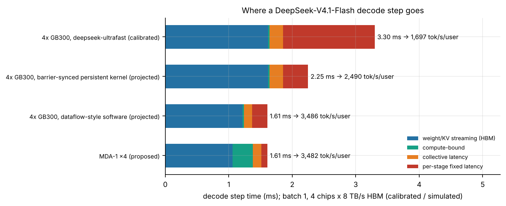
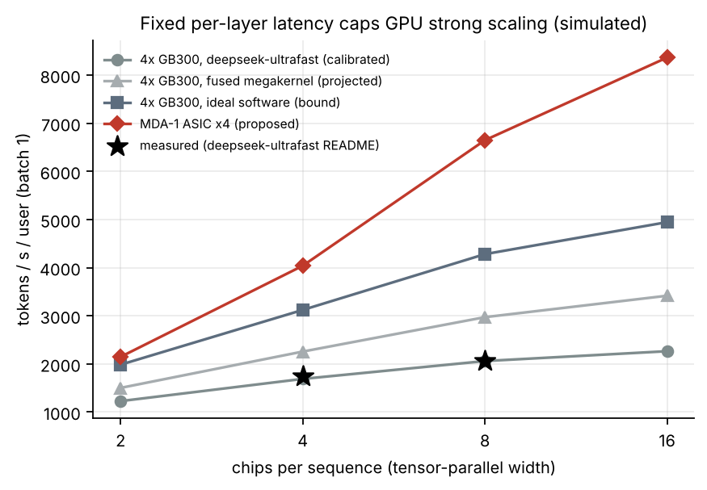
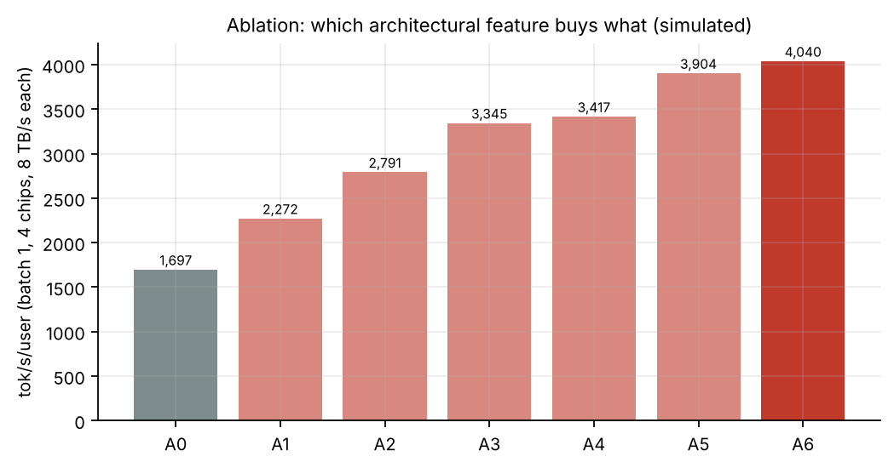
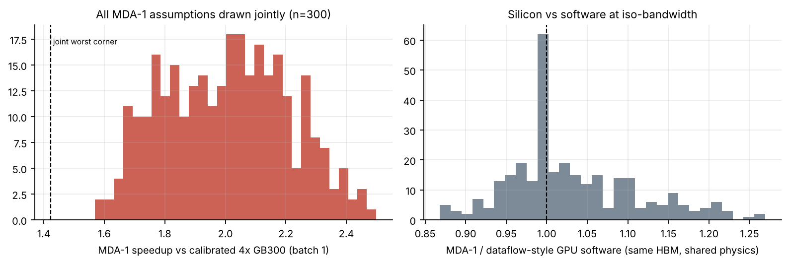
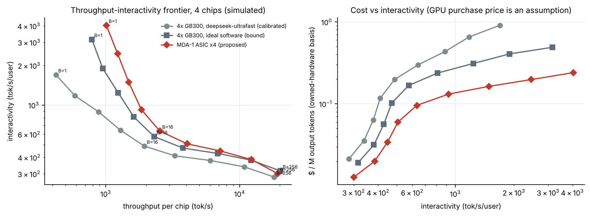
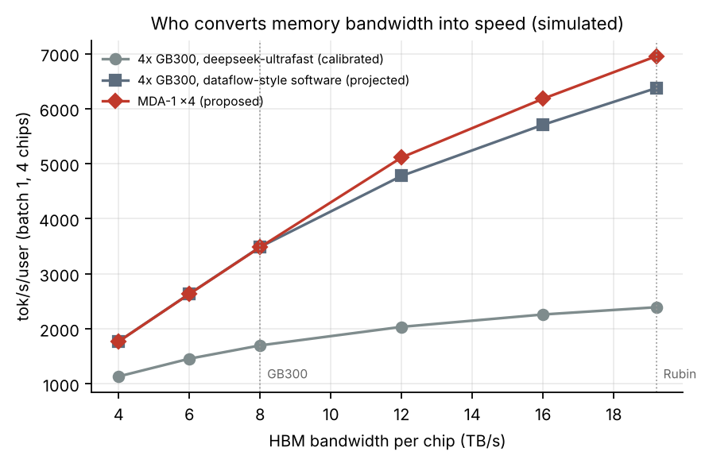
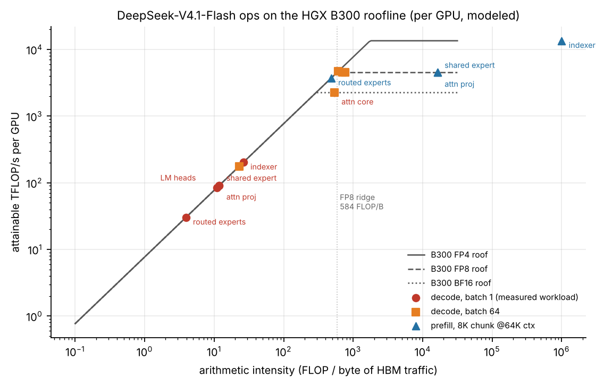

<!-- generated from docs/templates/POST.md.j2 by experiments/render_docs.py; edit the template -->
# Draft posts (Aercrist company account)

Repo: https://github.com/Aercrist/dsv41-accel-study
Each post lists the image to attach; the images are also shown inline below so this file previews on GitHub.
All numbers are modeled projections from the repo, except Baseten's published 1,740 tok/s.

## X thread

**1/**
DeepSeek-V4.1-Flash decode has ~2x headroom, and purpose-built silicon can deliver it at ~3x lower cost per token.

At Aercrist we modeled Baseten's deepseek-ultrafast (1,740 tok/s/user on 4x GB300) from its source code and the model's checkpoint to find out where the time goes. 🧵

📎 `results/fig_step_breakdown.png`

**2/**
About half of each 3.3 ms decode step is spent waiting between dependent steps (~43 µs per transformer block), not moving weights.

That's why 8 GPUs are only 22% faster per step than 4: more GPUs speed up the streaming, not the waiting.

📎 `results/fig_strong_scaling.png`

**3/**
Win #1 needs no new hardware. Run the model as one persistent program with flag hand-offs, and stream the next layers' weights while this layer's experts load.

Same 4x GB300, modeled: 3,596 tok/s/user, 2.1x today.

📎 `results/fig_ablation.png`

**4/**
Win #2 is silicon built for exactly this. Our MDA-1 design is a decode ASIC with the same 8 TB/s HBM, 2 PF FP8, a hardware MoE router (RTL-verified) and in-fabric all-reduce.

It reaches 3,656 tok/s/user, 94% of its memory roofline, and 1.6x-2.3x today's speed across a joint uncertainty analysis.

📎 `results/fig_monte_carlo.png`

**5/**
It's also far cheaper to run: ~3.2x lower $/token and ~3.9x more tokens per joule than today's engine.

Even against GPUs running the improved software, MDA-1 stays ~1.5x cheaper and ~1.8x more efficient. The GPU price and power assumptions, with ranges, are in the repo.

📎 `results/fig_batch_frontier.png`

**6/**
The gains compound. Once the waiting is gone, more memory bandwidth finally pays: Rubin running that execution model, or MDA-1 with HBM4, projects ~6,100 tok/s/user, 3.5x today.

📎 `results/fig_hbm_sweep.png`

**7/**
What we learned along the way:
• A classic 128x128 systolic array runs these decode GEMVs at 0.3-1.5% utilization (SCALE-Sim). The right engine is 16 rows wide.
• Engram's 203 GB of tables need only ~23 MB/s, so they belong in cheap LPDDR, not HBM.
• Our model reproduces DeepSeek's published 552B params and 890 B/token KV straight from the checkpoint.
• It held up through two rounds of adversarial review.

📎 `results/fig_roofline.png`

**8/**
Everything is open and reproducible: the simulator, calibration against Baseten's numbers, the Monte Carlo, the ablation and the router RTL. `make reproduce`.

Thanks to @basetenco for open-sourcing deepseek-ultrafast and to @deepseek_ai for V4.1.

→ https://github.com/Aercrist/dsv41-accel-study

## LinkedIn

📎 Attach `results/fig_step_breakdown.png` and `results/fig_ablation.png`.

**DeepSeek-V4.1-Flash decode has roughly 2x headroom, and purpose-built silicon can capture it at a fraction of the cost per token.**

Baseten open-sourced deepseek-ultrafast, a hand-tuned engine that decodes DeepSeek-V4.1-Flash at 1,740 tokens/s per user on 4x GB300. At Aercrist we used it as the reference workload for a hardware study and modeled where every microsecond goes.

What we found: about half of every decode step is spent waiting between dependent steps, not moving weights. A dataflow-style execution model removes that waiting.

- **On the same GPUs:** 2.1x the speed, with no new hardware (modeled).
- **On MDA-1,** our decode ASIC design built around that execution model: the same 2.1x, at about 3x lower cost per token and 4x the tokens per joule.
- **With next-generation HBM4:** about 3.5x today's speed.

The simulator, its calibration against Baseten's published numbers, a joint uncertainty analysis and a verified RTL block are all open source and reproducible with one command:
https://github.com/Aercrist/dsv41-accel-study

## Reply to the Baseten team

Hi Baseten team, this is Aercrist. Thanks for open-sourcing deepseek-ultrafast. It's the most legible serving engine we've read, and it made a serious hardware study possible.

We built an op-level performance model from the engine's source and V4.1's checkpoint headers. It accounts for PDL, the producer-pushed NVLS all-reduces, side streams, and what the `sgl` tensor maps actually stream. Fitted to your README's step times (3.30 ms TP4, 2.71 ms TP8), it attributes ~1.9 ms of each TP4 step (56%; 43%-62% across alternative fits) to dependent-stage latency, not weight streaming.

The headline for you: our model sees about 2.1x of decode headroom on the GPUs you already run. Three things you might find useful:

1. **Software projection.** On the same 4x GB300 the model projects about 3,596 tok/s/user from:
   - one persistent program with flag hand-offs, assuming a stage hand-off can get near 1 µs (the least certain part);
   - L2 prefetch of the next layers' dense weights while the current layer's experts stream.

   The prefetch piece is the least obvious: a layer's gate→expert gap is exactly when the next layers' attention and shared-expert weights can stream.
2. **TP8 scaling.** The model attributes the weak TP4→TP8 scaling to per-stage latency, not bandwidth.
3. **One profile settles it.** `tools/model_vs_nsys.py` prints our prediction in the exact groups of your `tools/nsys_breakdown.py`. One `nsys` run would confirm or kill the diagnosis. We'd love to compare notes if you're up for sharing a breakdown.

The ASIC side, MDA-1, is a simulated projection: the same speed as that software, at lower $/token and W/token at volume. Everything is here: https://github.com/Aercrist/dsv41-accel-study
