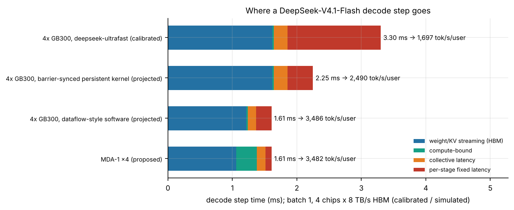
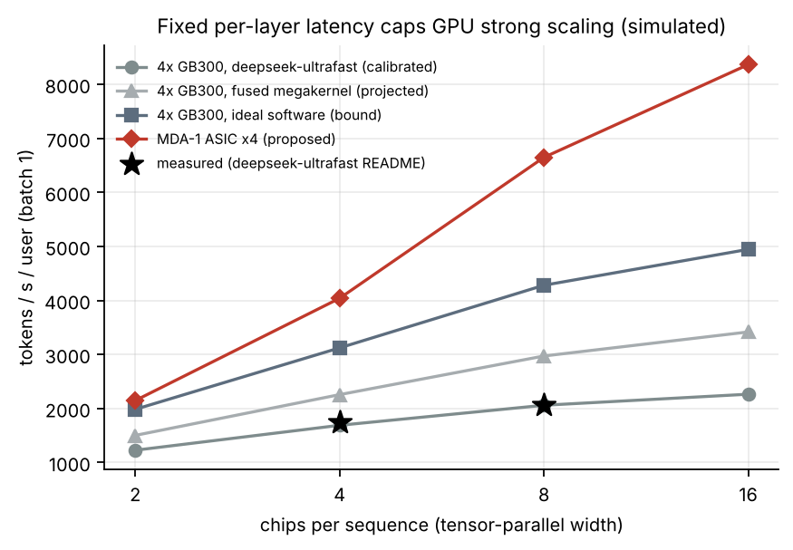

<!-- generated from docs/templates/README.md.j2 by experiments/render_docs.py; edit the template -->
# Decode silicon for DeepSeek-V4.1-Flash

**A modeled hardware-architecture study of [deepseek-ultrafast](https://github.com/basetenlabs/deepseek-ultrafast).**
All MDA-1 and projected-GPU numbers are **simulated/projected**; numbers marked *measured* are quoted from the deepseek-ultrafast README.

> **Status:** performance-model study plus one verified RTL block. No silicon, no synthesis, no GPU profiling.

## Abstract

deepseek-ultrafast serves DeepSeek-V4.1-Flash, a 552B-parameter MoE with FP4 experts, one request
at a time on 4 x GB300 (1,740 tok/s, *measured*) or 8 x B300 (2,060 tok/s, *measured*).
We rebuilt the workload from the engine's code and the model's checkpoint headers. We then built an
op-level performance simulator and calibrated it to the two reported step times; leave-one-out
error is 1.6%.

**Finding 1.** Only about 42% of each 3.30 ms decode step streams weights.
The other **1.9 ms (58%)** is fixed per-layer latency: kernel
boundaries and collectives. Over a step the GPUs average 37% of
peak HBM bandwidth. This is why 8 GPUs are only 22% faster than 4, and why Rubin's 2.75x
bandwidth would buy only about 37% with today's per-layer overheads.

**Proposal.** We propose **MDA-1**, a decode-only, statically scheduled ASIC: TSMC N4P, 8 x HBM3E at
the *same* 8 TB/s as a B300, 2 PF FP8, 256 MiB SRAM, a hardware MoE router and in-fabric all-reduce.
Four chips project to **4,040 tok/s/user (2.3x the measured 4 x GB300)**,
and eight chips to **6,464 (3.1x the measured 8 x B300)**. The model also projects
4.9x tokens/J and 3.8x lower $/M tokens than the same GPUs owned. The gain comes
almost entirely from deleting per-layer latency, not from FLOPs. Against an *ideal-software* GPU bound,
MDA-1's lead is 1.28x at 4 chips and grows to 1.51x at 8.





## Key results (simulated, batch 1, 4 chips at 8 TB/s HBM each unless noted)

| | tok/s/user | tokens/J | $/M tok (owned) |
|---|---|---|---|
| 4 x GB300, deepseek-ultrafast (*measured* 1,740; model 1,697) | 1,697 | 0.51 | 0.91 |
| 4 x GB300, fused megakernel (projected) | 2,272 | 0.68 | 0.68 |
| 4 x GB300, ideal software (bound) | 3,151 | 0.94 | 0.49 |
| 16 x Alveo V80 FPGA | 1,179 | 0.48 | 1.36 |
| **4 x MDA-1 (proposed)** | **4,040** | **2.45** | **0.24** |
| 4 x MDA-1 HBM4 vs 4 x Rubin (projected) | 6,796 vs 2,323 | 3.42 vs 0.54 | |

Robustness: across every MDA-1 uncertainty in the tornado (HBM efficiency, latencies, buffer size,
router), the speedup over the calibrated GPU stays between **2.12x and 2.51x**.
$/token is dominated by NRE and volume. Break-even against an ideal-software GPU owned at $45K/GPU is
about 6,420 chips at $300M NRE.
GPU purchase price and power are assumptions; see [limitations](docs/05_limitations.md).

## Method

1. **Workload from code** ([docs/01](docs/01_workload.md)): engine kernels, TP layout and DSpark speculation read from the Rust/CUDA source; shapes and on-disk bytes from the 48 safetensors headers. The model description reproduces the tech report's 552B / 196B / 16B / 8B parameters and 890 B/token KV exactly.
2. **Simulator** ([docs/06](docs/06_simulator.md)): an op-level event-driven scheduler over compute, chunked prioritized HBM and links, with two policies: GPU kernels, and statically scheduled dataflow with a prefetch window.
3. **Calibration**: 2 free GPU parameters fitted to 2 measured step times; leave-one-out with an independent STREAM bandwidth prior; refits under 5 alternative assumptions.
4. **Design + trade study** ([02](docs/02_design_rationale.md), [03](docs/03_architecture.md)): FPGA, SRAM-only, wafer-scale, GPU software and ASIC options run on the same simulator. The MoE router is written in SystemVerilog and verified against a golden model (256/256, 98 cycles). The matrix engine is cross-checked with SCALE-Sim v3, which corrected our model by 1.6x.
5. **Experiments** ([04](docs/04_results.md)): baseline vs proposed; sweeps over chips, batch, context, HBM bandwidth and SRAM; an expert-cache study (LRU/LFU/Belady); a tornado; and a 7-step ablation.

## Reproduce

```bash
pip install -r requirements.txt     # numpy, scipy, pyyaml, matplotlib, jinja2, pytest (+ scalesim)
make reproduce                      # all experiments -> results/, renders README + docs from results (~1 min)
make test                           # invariants + calibration checks
make rtl                            # optional: router RTL vs golden model (needs iverilog)
```

Every number in this README and in `docs/` is rendered from `results/*.json` by
`experiments/render_docs.py`. Edit `docs/templates/`, not the generated files.

## Limitations (short version)

Modeled projection, not silicon. The GPU model is calibrated on two points from one engine and one
prompt. MDA-1's latencies and energies are bottom-up assumptions (sourced where possible, swept where
not). Prefill is **not** calibrated: the measured prefill is 5.5x slower than our model. GPU power,
GPU purchase price, MAC area and NRE are assumptions. One `nsys` profile of deepseek-ultrafast would
confirm or refute the fixed-latency diagnosis: `python3 -m tools.model_vs_nsys` prints our per-group prediction in the
exact groups of the engine's own `tools/nsys_breakdown.py`. Full list: [docs/05_limitations.md](docs/05_limitations.md).

## Layout

```
data/        HF config, checkpoint manifest (from safetensors headers), reported baseline numbers
configs/hw/  GPU / ASIC / FPGA descriptions; every constant keyed to docs/sources.md
sim/         simulator (see docs/06)
experiments/ one script per study; run_all.py drives them
results/     generated JSON + figures
rtl/         MoE top-k router + testbench
docs/        01 workload · 02 rationale · 03 architecture · 04 results · 05 limitations · 06 simulator · sources
tools/       fetch_checkpoint_manifest.py (network; regenerates the manifest), model_vs_nsys.py (profile comparison)
POST.md      draft thread and note to the Baseten team
```

## Acknowledgments

Built on the public work of Baseten ([deepseek-ultrafast](https://github.com/basetenlabs/deepseek-ultrafast))
and DeepSeek-AI ([DeepSeek-V4.1-Flash](https://huggingface.co/deepseek-ai/DeepSeek-V4.1-Flash) and its technical report).
This study is independent and not affiliated with or endorsed by either.
