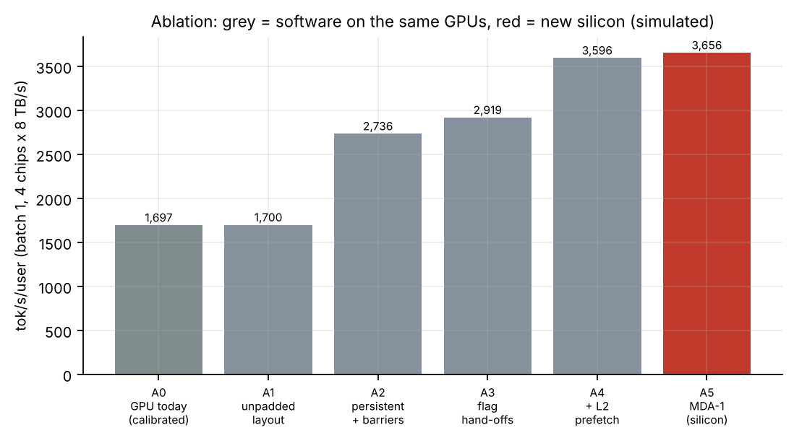

<!-- generated from docs/templates/README.md.j2 by experiments/render_docs.py; edit the template -->
# Decode silicon for DeepSeek-V4.1-Flash

**A modeled hardware-architecture study of [deepseek-ultrafast](https://github.com/basetenlabs/deepseek-ultrafast):
where the time goes, what a custom accelerator would buy, and how much of that software can buy first.**
All MDA-1 and projected-GPU numbers are **simulated/projected**. Numbers marked *measured* are quoted from the deepseek-ultrafast README.

> **Status:** performance-model study plus one verified RTL block. No silicon, no synthesis, no GPU profiling.
> The claims were revised after an adversarial review ([what changed](docs/05_limitations.md#revisions-after-adversarial-review)).

## Abstract

deepseek-ultrafast serves DeepSeek-V4.1-Flash, a 552B-parameter MoE with FP4 experts, one request at
a time: 1,740 tok/s on 4 x GB300 and 2,060 tok/s on 8 x B300 (*measured*).
We rebuilt the workload from the engine's Rust/CUDA source and the model's checkpoint headers. We
then built an op-level performance simulator and calibrated it to the two reported step times.

1. **About half of every decode step is fixed latency, not weight streaming.** The calibrated model
   attributes 1.85 ms of the 3.30 ms step (56%) to dependent-stage
   and collective latency (43%-62% across every alternative calibration).
   HBM averages 37% of peak.
2. **The fix is an execution model, not FLOPs.** It replaces dependent kernel launches with one
   persistent, statically ordered program that hands off between stages with flags. It streams the next
   layers' dense weights while the current layer's experts are in flight. On the **same 4 x GB300**
   this projects **3,596 tok/s/user (2.1x the measured engine)**. The
   levers are the persistent program (+61% if a stage hand-off can be cut to ~1 µs, the least
   certain step), flags (+7%) and cross-layer weight prefetch (+23%).
3. **Custom silicon built around that execution model matches it. It doesn't beat it.** MDA-1 is a
   decode ASIC: 2 dies, 8 x HBM3E at GB300's 8 TB/s, 2 PF FP8, a hardware MoE router (RTL-verified)
   and in-fabric all-reduce. It projects **3,656 tok/s/user**, 94% of its HBM roofline. Drawing all its
   assumptions jointly, that is 1.6x-2.3x the measured engine (5th-95th percentile), and
   0.92x-1.19x the same-bandwidth GPU software (median 1.01x). **Its case is economic:**
   1.5x lower $/M tokens and 1.8x tokens/J against GPUs running the same software
   (GPUs owned at $45K, drawing 60% of TDP). Across $25-65K per GPU and 40-100% of TDP those ratios span
   0.9x-2.1x and 1.2x-3.0x. Break-even is about 9,000 chips at $300M NRE.
4. **Bandwidth alone won't fix it.** Rubin (19.2 TB/s, 2.4x GB300) with today's per-stage
   latency projects only +35% over GB300. With dataflow-style software on both,
   Rubin's bandwidth buys 1.71x (6,149 vs 3,596 tok/s/user).




## Key results (batch 1, 4 chips; simulated unless marked)

| platform | tok/s/user | tokens/J † | $/M tok, owned ‡ |
|---|---|---|---|
| 4 x GB300, deepseek-ultrafast: *measured* 1,740; calibrated model | 1,697 | 0.51 | 0.91 |
| 4 x GB300, barrier-synced persistent kernel (projected) | 2,728 | 0.81 | 0.57 |
| **4 x GB300, dataflow-style software (projected)** | **3,596** | 1.07 | 0.43 |
| 16 x Alveo V80 FPGA | 1,180 | 0.49 | 1.36 |
| **4 x MDA-1 (proposed)** | **3,656** | **1.95** | **0.27** |
| 4 x Rubin, today's software / dataflow software (projected) | 2,284 / 6,149 | 0.53 / 1.42 | |
| 4 x MDA-1 with HBM4 at Rubin's bandwidth (projected) | 6,159 | 2.67 | 0.19 |

† GPU power is an *assumption* (60% of TDP); MDA-1 power is bottom-up. ‡ GPUs at an *assumed* $45K all-in
(no public B300 price); MDA-1 at manufacturing cost plus $300M NRE over 20K chips; 4-year life. A GPU
prefill pool adds $0.027/M to every row equally. At the $9.50/GPU-hr market rental the GPU baseline is
$6.22/M.

## Method

1. **Workload from code** ([docs/01](docs/01_workload.md)). Engine kernels, TP layout, padded expert layout, fusions and DSpark speculation are read from the Rust/CUDA source. Shapes and bytes come from the 48 safetensors headers, which reproduce the tech report's 552B / 196B / 16B / 8B parameters and 890 B/token KV.
2. **Simulator** ([docs/06](docs/06_simulator.md)). An op-level, event-driven scheduler over compute, chunked prioritized HBM and links, with two policies: GPU kernels, and a statically scheduled dataflow with a prefetch window. Platforms differ only in constants. Same-physics constants are set equal across platforms: HBM efficiency, DRAM first-byte latency, and the best measured 4-GPU all-reduce.
3. **Calibration.** 2 free GPU parameters fitted to 2 measured step times, refit under 10 alternative assumptions, including the README's run-to-run extremes. Leave-one-out: +2.3% / -1.9% with an independent STREAM bandwidth prior. That is a weak test, and we say so. An adversarial reviewer checked the study twice ([what changed](docs/05_limitations.md#revisions-after-adversarial-review)).
4. **Design and trade study** ([02](docs/02_design_rationale.md), [03](docs/03_architecture.md)). GPU software, FPGA, SRAM-only, wafer-scale and ASIC options run on one simulator. The MoE router is SystemVerilog, verified against a golden model (256/256, 98 cycles). The matrix engine is cross-checked with SCALE-Sim v3, which corrected our model by 1.6x.
5. **Experiments** ([04](docs/04_results.md)). Baseline vs proposed vs software; joint Monte Carlo; sweeps over chips, batch, context, HBM bandwidth and SRAM; an expert-cache study (LRU/LFU/Belady); a tornado; and an ablation that separates software steps from silicon.

## Reproduce

```bash
pip install -r requirements.txt     # numpy, scipy, pyyaml, matplotlib, jinja2, pytest (+ scalesim)
make reproduce                      # all experiments -> results/, renders README + docs from results (~1-2 min)
make test                           # invariants + calibration checks
make rtl                            # router RTL vs golden model (needs iverilog; run by reproduce if present)
python3 -m tools.model_vs_nsys      # our per-kernel-group prediction, to compare with one nsys profile
```

Every number in this README, `docs/` and `POST.md` is rendered from `results/*.json` by
`experiments/render_docs.py`. Edit `docs/templates/`, not the generated files.

## Limitations (short version)

This is a modeled projection, not silicon. The GPU model is calibrated on two points from one engine
and one prompt. The fixed-latency share is a range, not a measurement. One `nsys` profile would
confirm or refute it. MDA-1's constants are bottom-up assumptions, sourced where possible and swept
jointly. Prefill is **not** calibrated: the measured prefill is 5.4x slower than our model.
GPU power and purchase price, MAC and SerDes area, NRE and volume are assumptions. Full list:
[docs/05_limitations.md](docs/05_limitations.md).

## Layout

```
data/        HF config, checkpoint manifest (from safetensors headers), reported baseline numbers
configs/hw/  GPU / GPU-software projections / ASIC / FPGA descriptions; every constant keyed to docs/sources.md
sim/         simulator (see docs/06)
experiments/ one script per study; run_all.py drives them
results/     generated JSON + figures
rtl/         MoE top-k router + testbench
docs/        01 workload · 02 rationale · 03 architecture · 04 results · 05 limitations · 06 simulator · sources
tools/       fetch_checkpoint_manifest.py (network), model_vs_nsys.py (profile comparison)
POST.md      draft thread and note to the Baseten team
```

## Acknowledgments

Built on the public work of Baseten ([deepseek-ultrafast](https://github.com/basetenlabs/deepseek-ultrafast))
and DeepSeek-AI ([DeepSeek-V4.1-Flash](https://huggingface.co/deepseek-ai/DeepSeek-V4.1-Flash) and its technical report).
This study is independent and not affiliated with or endorsed by either.
