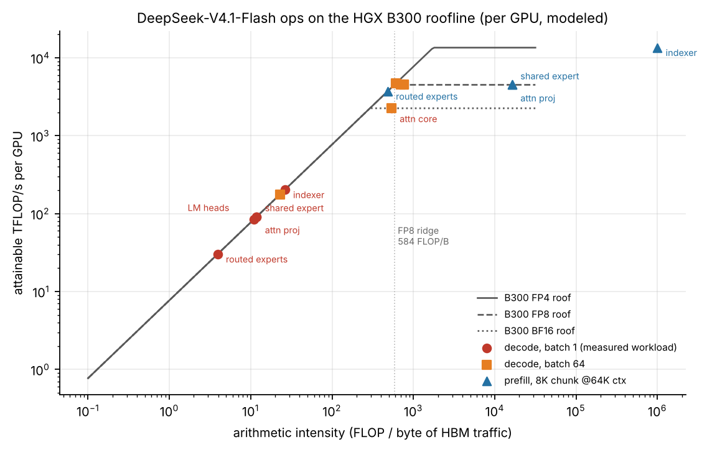
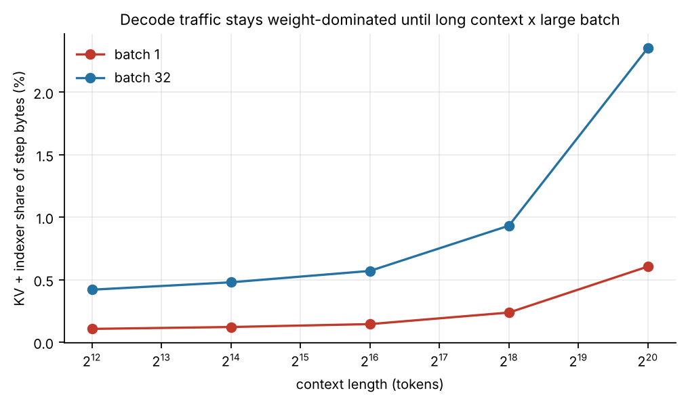

<!-- generated from docs/templates/01_workload.md.j2 by experiments/render_docs.py; edit the template -->
# 01 · The workload: DeepSeek-V4.1-Flash on deepseek-ultrafast

All numbers on this page come from the code. The inputs are the released model files and
`basetenlabs/deepseek-ultrafast` @ `76766a97`. The outputs are from
`experiments/workload_analysis.py` → `results/workload.json`. We quote the deepseek-ultrafast
measurements. We did not reproduce them. The rest is **modeled**.

## 1. What the engine runs (read from the code, not the README)

The repository serves DeepSeek-V4.1-Flash (not V3/R1) on Blackwell Ultra:

| item | value | where it comes from |
|---|---|---|
| model | **DeepSeek-V4.1-Flash**: 40-layer Causal Encoder-Decoder (20 + 20), multimodal, 552B backbone + 196.6B Engram parameters | `crates/model/src/config.rs`, HF `config.json` |
| hardware | 4 x GB300 (TP4) or 8 x B300 (TP8), `sm_103a` | README |
| batch | **one request at a time**: the server holds one `Job` that each rank executes | `crates/server/src/engine.rs` (`Shared.job`, `next_job`) |
| parallelism | pure tensor parallelism. The engine shards query heads, `wo_a` groups, `wo_b` rows, the vocab, **and each routed/shared expert by its intermediate dim** (2304/TP). The engine **replicates** `wq_a`+`wkv`, the indexer `wq_b`, compressor, gate and mHC projections. There is no expert parallelism and no all-to-all. Each layer has two all-reduces, fused with the mHC epilogue (NVLS / Lamport buffers) | `crates/engine/src/weights.rs::layer`, `model.rs::comm_ex`, `cu/comm.cu` |
| speculation | DSpark: 3 drafter blocks (SWA-only attention, 128-expert top-3 MoE) draft 5 tokens. The backbone verifies **6 rows** per step (adaptive length through a CUDA-graph conditional switch) | `model.rs::capture_spec_blk`, `capture_spec_vadapt` |
| weights | routed experts **FP4 E2M1** with an E8M0 scale per 32 (stored as packed `I8`), dense projections **FP8 E4M3** with E8M0 per 32x32 block, head **BF16** (the engine uses an FP8 copy for the draft, and for verify on GB300 TP4). In memory, the engine pads the slice of each rank to 128 rows. But the routed-expert tensor maps read only the real rows plus the 64-row padding of w2: **+0.0% streamed routed-expert bytes at TP4, +3.5% at TP8**. The engine reads the FP8 copy of the shared expert with its padding | safetensors headers (`data/checkpoint_manifest.csv`), `ops.rs::verify_head_fp8`, `packing.rs::sgl_expert_bytes`, `model.rs::sgl_init` |
| KV cache | main (compressed) KV **FP4** E2M1 + E4M3 scale per 16 ch; SWA KV FP8; indexer K FP4 | tech report §2.4.4, `inference/model.py` |
| kernels | hand-written CUDA for tcgen05: weight-streaming GEMV (`tcgemv*`), fused MoE (`tcmoe`, `sgl`), sparse attention, top-k, Mega-mHC (`hcpipe`), Markov draft head, Gumbel sampler. Each launch uses programmatic dependent launch (PDL). The indexer, compressor and mHC dot products run on side streams. The producer kernel pushes the all-reduces (NVLS multimem + Lamport buffers). Our op graph counts about 388 dependent kernel stages per step on the critical path (approximate) | `crates/kernels/cu/*.cu`, `model.rs` (`launch`, `par_fork`, `comm_ex`) |

Reported performance (README @ `76766a97`, prompt: *"implement the tetris game…"*, thinking off):

| config | decode tok/s | step time | acceptance | 1M-token prefill |
|---|---|---|---|---|
| 4 x GB300, TP4 | 1,740 (1,700-1,770) | 3.30 ms (3.24-3.37) | 5.6 tok/step | 13.2 s |
| 8 x B300, TP8 | 2,060 (1,980-2,170) | 2.71 ms (2.69-2.74) | 5.6 tok/step | 11.7 s |

With 8 GPUs and not 4, a step is only **22% faster** (18% more tokens/s).
Section 6 gives the cause. The rest of the study follows from that cause.

## 2. Architecture numbers

From `data/deepseek_v41_flash_inference_config.json`:

| | value | | value |
|---|---|---|---|
| hidden dim | 5,120 | layers | 40 (20 encoder + 20 decoder) + 3 DSpark drafter blocks |
| query heads x head dim | 64 x 512 (RoPE 64) | KV | **one 512-wide latent per token, shared by all heads as K and V** (MLA-style, absorbed) |
| q LoRA rank | 1,280 | output projection | 8 groups x 1,024 LoRA rank (`wo_a`), then 8,192 → 5,120 (`wo_b`) |
| sparse attention | SWA window 128 + top-512 compressed entries | compression | ratio 2 (layers 2-19), ratio 1 (20-39), SWA-only (0-1) |
| CSA2 modes | Full at 2, 8, 14, 20 · Reindex at 24, 28, 32, 36 · Reuse elsewhere | indexer | 32 heads x 128 dim (FP4); candidate pool 2,048 blocks x 8 from layer 20 |
| MoE | 384 routed (top-6, sqrt-softplus, `noaux_tc` bias) + 1 shared; intermediate 2,304 | expert size | **18.80 MB** (FP4 + scales); shared 35.4 MB (FP8) |
| mHC | 4 residual streams, Sinkhorn 20 iters | Engram | layers 1 and 14, 2 x 384M x 256 FP8 rows, n-gram 2-4, 8 heads |

**Validation against the tech report.** We computed each of these quantities from the raw checkpoint bytes and shapes. They agree with the paper to its stated precision. The KV figure agrees exactly:

| quantity | paper | ours |
|---|---|---|
| backbone parameters | 552B | 551.88B |
| Engram parameters | 196B | 196.61B |
| activated / token, decode | 16B | 16.09B |
| activated / token, prefill | 8B | 7.84B |
| global KV bytes / token | 890 | 890 |
| weighted decode FLOPs, 1M vs 4K context | +1/4 | +33% |

The last row is the one discrepancy. Figure 2 of the paper reports +25% decode FLOPs from 4K to 1M
context. Our op count gives +33%. Almost all of the growth comes
from indexer scoring. The layer-20 Full indexer scans the full context, and the three
encoder Full indexers scan half of it.

We attribute the extra growth to a difference in convention
(for example, whether the count includes the index-score reduction). The discrepancy has no effect at the measured
~2.6K context, where the indexer is less than 1% of a step.

## 3. Decode: FLOPs and bytes per output token

One step drafts 5 tokens, verifies 6 rows through all 40 layers and emits 5.6 tokens on
average. With independent routing, the 6 verify rows touch **34.6
distinct experts per layer**. The drafter touches 14.3 per block. One step reads
**36.1 GB** of unique bytes and does 229 GFLOP.
The table shows these values per emitted token (system-wide, batch 1, context 2.6K):

| op class | FLOPs / token | HBM bytes / token | FLOP/B | bound on B300 (FP8 ridge 584 FLOP/B) |
|---|---|---|---|---|
| CSA2 attention projections (wq_a, wkv, wq_b, wo_a, wo_b) | 12 GFLOP | 981 MB | 11.8 | memory (49x below ridge) |
| sparse attention core (SWA window + top-512 latent KV) | 3.5 GFLOP | 6.5 MB | 536.3 | near ridge |
| indexer score/top-k + KV compressor | 192 MFLOP | 7.3 MB | 26.3 | memory (22x below ridge) |
| MoE gate + top-k routing | 172 MFLOP | 29 MB | 6.0 | memory (98x below ridge) |
| shared expert (FP8) | 3.2 GFLOP | 272 MB | 11.8 | memory (49x below ridge) |
| routed experts (FP4 x FP8) | 19 GFLOP | 4.8 GB | 3.9 | memory (149x below ridge) |
| mHC residual mixing (Sinkhorn) | 90 MFLOP | 30 MB | 3.0 | memory (197x below ridge) |
| Engram n-gram memory | 674 MFLOP | 56 MB | 12.0 | memory (49x below ridge) |
| TP all-reduce / gathers | 0 FLOP | 0 B (+5.6 MB on links) | - | latency |
| DSpark drafter glue (main_proj, Markov head) | 87 MFLOP | 26 MB | 3.4 | memory (173x below ridge) |
| LM heads (draft + verify) + sampling | 2.6 GFLOP | 237 MB (+823 B on links) | 11.0 | memory (53x below ridge) |

Notes:
- **Routed experts dominate.** They are 74% of all bytes and run at about 4 FLOP/B: each touched expert serves about one row.
- **Attention core** (one shared 512-wide latent, 64 heads) has high arithmetic intensity, because the KV is tiny: 6.5 MB per token.
- **All-to-all vs all-reduce.** Expert parallelism moves 737 kB per layer (dispatch + combine of 6 rows x 6 experts x 5,120 x BF16). The two TP all-reduces of the engine move 123 kB per layer. Both are tiny. Thus, at batch 1, the cost of collectives is latency, not bandwidth.
- **Engram is a capacity problem, not a bandwidth problem.** The two tables hold 203 GB. The engine shards them into GPU HBM, 51 GB per GB300. A step looks up only 76 kB: about 23 MB/s. The token ids give the addresses before the step starts (tech report §2.4.2).

Per GPU, per step (the TP sharding and replication above):

| | TP4 (GB300) | TP8 (B300) |
|---|---|---|
| sharded dense weights | 2.13 GB | 1.19 GB |
| replicated weights (wqkv, gate, mHC, indexer, compressor) | 0.81 GB | 0.81 GB |
| routed experts | 6.71 GB | 3.47 GB |
| KV + index K | 0.038 GB | 0.038 GB |
| **total** | **9.69 GB** | **5.51 GB** |
| ...in the measured step time | 2.94 TB/s of 8.0 | 2.03 TB/s of 7.7 |

This table shows the engine *as built*. It includes streamed layout padding, and an FP8 verify head at TP4 but BF16 at TP8.
The per-token table above uses on-disk bytes. Thus the GPUs use an average of **37%** (TP4) and
**26%** (TP8) of their peak HBM bandwidth during a step.

## 4. Prefill: per prompt token

With CED, prefill runs only the 20 encoder layers over each prompt token. Then it projects the
global KV of the decoder from the encoder output. It replays only the last 128 tokens through the decoder
(tech report §2.2, §3.2.2). The table shows the values per prompt token at position 1M, in 8K-token chunks:

| op class | FLOPs / token | HBM bytes / token (amortized over the chunk) |
|---|---|---|
| CSA2 attention projections (wq_a, wkv, wq_b, wo_a, wo_b) | 5.1 GFLOP | 309 kB |
| sparse attention core (SWA window + top-512 latent KV) | 1.5 GFLOP | 0 B |
| indexer score/top-k + KV compressor | 13 GFLOP | 13 kB |
| MoE gate + top-k routing | 79 MFLOP | 9.6 kB |
| shared expert (FP8) | 1.4 GFLOP | 86 kB |
| routed experts (FP4 x FP8) | 8.5 GFLOP | 18 MB |
| mHC residual mixing (Sinkhorn) | 39 MFLOP | 9.6 kB |
| Engram n-gram memory | 629 MFLOP | 51 kB |

Prefill is compute-bound everywhere except the routed experts. An 8K chunk touches all 384 experts
per layer, and this puts them near the ridge. The quadratic indexer term is the largest compute item
at 1M context. The reported 1M-token prefill is 13.2 s. Our roofline model gives
5.4x less (section 3 of [04](04_results.md#prefill-and-ttft)). Thus prefill
is *not* a calibrated part of this study.

## 5. Roofline on the GPU baseline

Batch-1 decode ops are 20-150x left of the B300 FP8 ridge (584 FLOP/B). Even at
batch 64 the routed experts stay memory-bound, because each expert still gets only about 6 rows.
The dense GEMMs of prefill are far to the right. Decode is a memory-bandwidth problem in the roofline
sense. Section 6 shows that, at batch 1, it is *also* a latency problem.

CSA2 + FP4 KV keep KV traffic negligible: less than 1% of step bytes at batch 1, even at 1M tokens. The
indexer scan is important only for long context *and* large batch.

## 6. The bottleneck is not where the roofline says

At 3.30 ms per step, the 4 x GB300 use an average of 37% of
peak HBM bandwidth. We calibrated the execution model to the two measured step times
([06_simulator.md](06_simulator.md#calibration)). The calibration divides each step into two parts. One part scales
with bytes per GPU. The other part does not:

| | 4 x GB300 (3.30 ms) | 8 x B300 (2.71 ms) |
|---|---|---|
| weight/KV streaming | 1.42 ms | 0.84 ms |
| per-stage fixed latency + collective latency | **1.85 ms (56%)** | **1.86 ms (68%)** |

The fixed part is about 43 µs per transformer block, across about
9 dependent kernel stages. This count includes the fused all-reduces. With PDL, these
are not launch gaps. They are the latency of dependent stages. The output of each kernel must be complete
across the GPU before the next kernel can use it. Ramp, tail and collective latency add to this.

The fitted value, 4.2 µs per stage, is consistent with published measurements
([sources](sources.md): >1 µs per device-wide barrier, 2.4-5 µs per small 4-GPU all-reduce).

**How sure are we?** The two data points give the *sum* of fixed costs. They do not give a tight value
for the division between kernel stages and collectives, or for the bandwidth efficiency. We refitted under each
alternative that we found. The fixed share of the TP4 step then moves between
**43% and 62%** ([04](04_results.md#calibration)). The alternatives
are per-peer all-reduce growth, routing locality, and the run-to-run extremes of the README.

The range is consistent with a TP8 step that is only 22% faster than a TP4 step. But that number is an
input to the fit, not independent evidence. One profile
(`tools/model_vs_nsys.py` next to the `tools/nsys_breakdown.py` of the engine) can settle this question.
