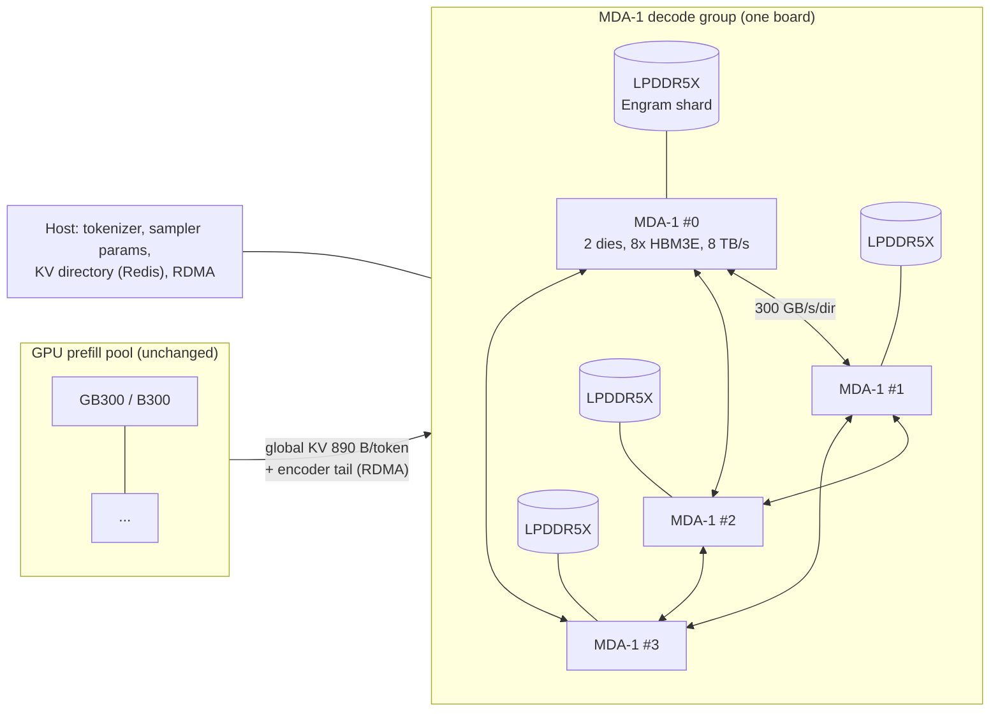
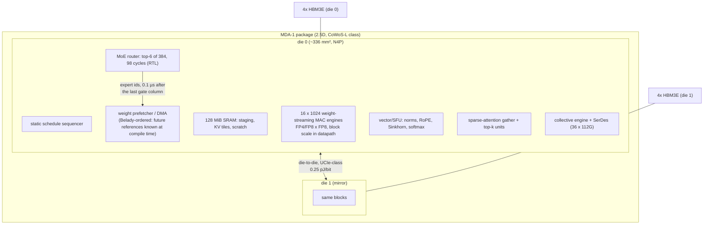
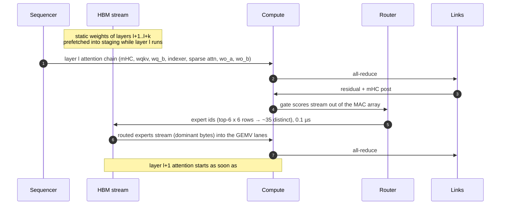

<!-- generated from docs/templates/03_architecture.md.j2 by experiments/render_docs.py; edit the template -->
# 03 · MDA-1 micro-architecture

MDA-1 ("MoE Decode ASIC") is a **proposed, simulated** design. Nothing here is silicon. Each
quantitative property below comes from a simulator output (`configs/hw/asic_mda1.yaml`,
`results/decode.json`) or from the RTL testbench (`rtl/`). One MDA-1 "chip" is a **package of two dies**.
Each die has four HBM3E stacks, like a B300.

## 1. System

A decode group is 4 MDA-1 packages on one board, with a full mesh. A GPU prefill pool hands over KV through
RDMA: 890 B/token of global KV plus a 128-row SWA replay.

The partition is the TP4 layout of the engine: heads, `wo` groups, experts by intermediate dim. We store
experts unpadded. A layer has 2 all-reduces of 6 x 5,120 BF16. More than 4 packages need a
switched fabric. This study does not design that fabric.

The GPU engine replicates some projections. If MDA-1 shards these projections
(`DecodeWorkload.shard_replicated`), MDA-1 becomes *slower*: 2,811
vs 3,656 tok/s/user. The extra collectives cost more than the 0.8 GB of replicated
reads that they save.

## 2. Package and die

Each die streams its own half of each sharded weight from its own 4 stacks. Only activations and
partial sums cross the die-to-die link. For the crossing, the model adds +0.1 µs per op hand-off and +0.2 µs per
all-reduce (assumption).

### Area (bottom-up, `sim/energy.py::asic_area`)

| block (package total) | mm² | basis |
|---|---|---|
| 8 x HBM3E PHY + controller | 96 | 12 mm² per stack (GUC: 11 mm² PHY, unverified) |
| 256 MiB SRAM | 128 | N5 HD ≈ 32 Mib/mm² array, x2 for periphery |
| 2 PF FP8 MAC array | 53 | 667K FP8 MACs x 80 µm² (assumption; not sourced) |
| 72 x 112G SerDes lanes | 50 | 0.7 mm²/lane (assumption) |
| LPDDR5X PHYs | 12 | 4 channels |
| die-to-die PHYs | 20 | 10 mm² per die (assumption) |
| NoC, control, misc | 90 | +25% |
| **logic sum** | 450 | |
| **2 dies at the HBM shoreline floor**: 2 stacks x 11 mm (+2 mm) per long side, ≥14 mm short side | **2 x 336** | 222 mm² whitespace |

Each die is shoreline-bound: four HBM stacks need edge, not area. Thus SRAM up to the floor adds
almost no cost. Also, N3E decreases only the logic, and the logic does not set die size. Silicon cost is about
$271 per package (174 dies/wafer, Murphy yield 72% at D0 = 0.10/cm²).
HBM and packaging dominate the BOM. NRE dominates unit cost ([04](04_results.md#cost)).

## 3. How a decode step flows

**The design rule** applies to MDA-1 and to GPU software alike. For one sequence, the expert
fetch of layer *l* cannot start until the attention chain and gate of layer *l* finish. The HBM stays busy only if that
chain finishes before the prefetcher has no more *static* (data-independent) weights to stage. At TP4
that is about 55 MB per package per layer: 29 MB sharded attention, 9 MB shared expert, 17 MB
replicated projections. That is about 8 µs at the calibrated 6.7 TB/s.

The condition holds on average, not per layer. With a staging buffer of a few layers, a slightly longer chain
can use some static bytes of the next layer. The HBM is idle only for the cumulative excess.

| chain per layer | time | HBM busy |
|---|---|---|
| MDA-1: ~13 ops x 0.3 µs + 2 x 2.57 µs all-reduce + router + first byte | ~9 µs | 94% |
| GPU dataflow-style software: ~13 x 0.5 µs hand-offs + 2 x 2.37 µs + router + first byte | ~12 µs | 92% |
| GPU today: ~9 dependent kernel stages x 4.2 µs + collectives | ~43 µs | 44% |

The first two rows keep the HBM mostly busy. Thus they get almost the same speed. The
budget decreases when we add packages, because the static bytes per layer of each package decrease
([04](04_results.md#strong-scaling)).

## 4. Datapaths and number formats

- **FP4 x FP8 GEMV lanes.** Expert weights arrive as E2M1 nibbles with one E8M0 exponent per 32 elements. The lane multiplies by the FP8 E4M3 activation, accumulates 32 products in FP32, then applies the block scale. E8M0 is a power of two. Thus the scale is an exponent add on the partial sum, not a multiply. The same lane accepts FP8 x FP8 for dense projections (E8M0 per 32x32 block).
- **Engine shape.** Each engine has 16 rows (GEMM M) x 1,024 columns. Decode gives M = 6 (verify rows), about 1 row per routed expert at batch 1. SCALE-Sim shows a 128x128 weight-stationary array at 0.3-1.5% utilization on these shapes, and the 16-row engine at 3-21% ([04](04_results.md#scale-sim)). Batch-1 decode needs only ~0.2 PF effective. Thus utilization is a limit only at batch ≥ 16.
- **Sparse-attention unit.** The unit gathers 128 SWA entries (FP8) and 512 top-k latent entries (FP4 + E4M3/16) per row. It dequantizes the entries as they arrive, and runs 64-head QK/PV with the attention sink. One gather serves all 64 heads (536 FLOP/B, 01 §3).
- **Top-k units.** These are streaming insertion networks for indexer top-512 (up to 1M scores at layer 20) and the 2,048-block candidate pool.

## 5. MoE router in hardware (verified RTL)

`rtl/moe_topk_router.sv` has 8 lanes of 6-entry insertion queues. The lanes absorb 8 gate keys per cycle
(48 beats for 384 experts). Then a 48-entry merge pass produces the result. The selection key is
sqrt-softplus(logit) plus the `noaux_tc` bias. Ties go to the lower expert id.

**256/256 tokens match a numpy golden model in Icarus Verilog. The latency is 98 cycles
(65 ns at 1.5 GHz).** In the tornado, a router latency from 0.05 to 2 µs changes
speed by less than 1%, because the prefetcher hides it. **The hardware router is not the reason to build silicon.**

## 6. Ideas from other fields, and their gain (simulated)

| idea | from | where it applies | gain |
|---|---|---|---|
| unpadded expert layout | -- | software | A0→A1 ±0% (the streamed padding is +3.5% of routed bytes at TP8, ~0 at TP4) |
| one persistent program, no per-kernel completion | Groq/Cerebras static scheduling; GPU megakernels | software or silicon | A1→A2 +61% (barriers), A2→A3 +7% (flags) |
| Belady/MIN-optimal weight prefetch | caching theory: the static schedule *is* the future reference string | software (TMA L2 prefetch) or silicon (staging SRAM) | A3→A4 +23% |
| in-network all-reduce | HPC (BlueGene, Anton) | already in the GPU baseline (NVLS reduces in the switch); MDA-1 assumes no faster link | ±0 by construction |
| on-chip hand-off, HW router, Engram off-HBM | Etched-style specialization | silicon only | A4→A5 +2% at 4 chips |
| LRU/LFU cache of experts | CDN / CPU caches | SRAM expert cache | **no**: half of MDA-1's SRAM holds 0.7 expert slices per layer; a 22% LRU hit needs 9 GB per chip |
| pre-gating / expert prediction | Pre-gated MoE (ISCA'24) | expert fetch before the gate | not needed: router latency is already hidden |

## 7. Power (bottom-up, batch 1)

| | J per step (4 packages) | share |
|---|---|---|
| hbm | 1.235 | 43% |
| sram | 0.154 | 5% |
| compute | 0.061 | 2% |
| links | 0.001 | 0% |
| host_dram | 0.000 | 0% |
| noc | 0.154 | 5% |
| static | 0.919 | 32% |
| power_delivery_loss | 0.344 | 12% |

That is an average of **468 W per package** at 3,656 tok/s/user. HBM uses the
HBM2 figure (3.97 pJ/bit), because the absolute figure of HBM3E is not public. NoC transport is 0.5 pJ/bit and
power delivery is 88% efficient. The two values are assumptions.
