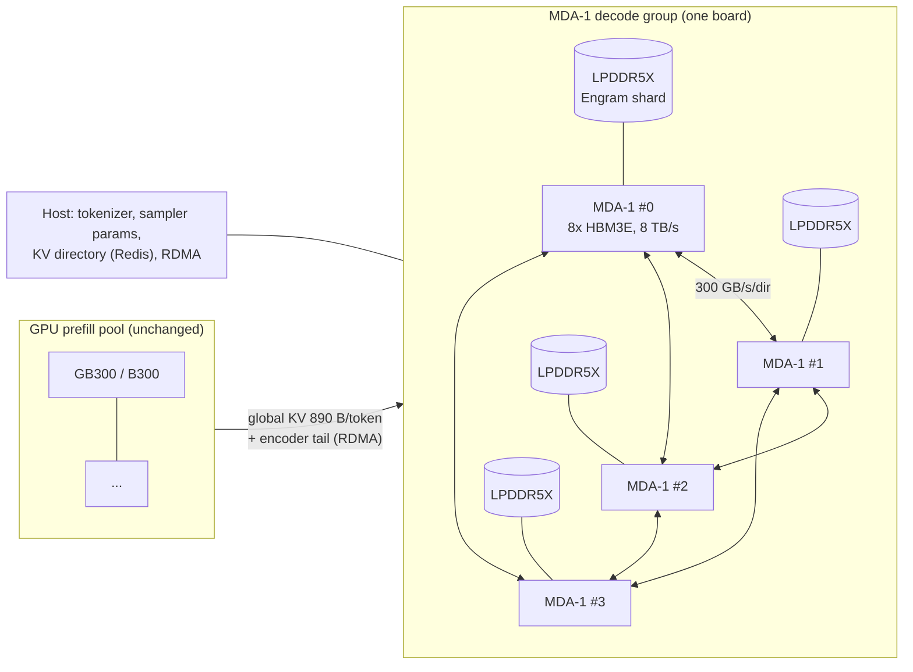
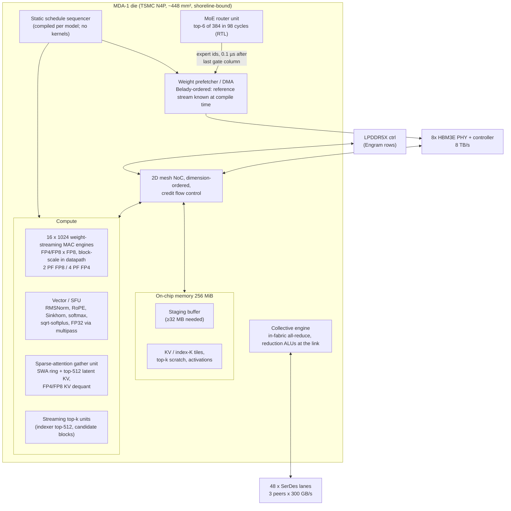
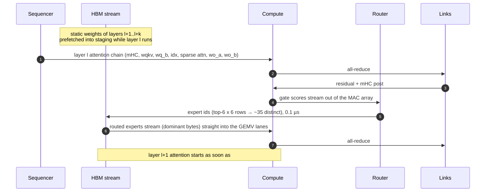

<!-- generated from docs/templates/03_architecture.md.j2 by experiments/render_docs.py; edit the template -->
# 03 · MDA-1 micro-architecture

MDA-1 ("MoE Decode ASIC") is a **proposed, simulated** design. Nothing here is silicon. Every
quantitative property cited below is a simulator output (`configs/hw/asic_mda1.yaml`,
`results/decode.json`) or the RTL testbench (`rtl/`).

## 1. System

A decode group is 4 MDA-1 packages on one board, fully meshed. A GPU prefill pool hands KV over RDMA
(890 B/token of global KV plus a 128-row SWA replay).

Partitioning is the engine's TP4 layout (heads, `wo` groups, experts by intermediate dim). Collectives
are 2 all-reduces of 6 x 5,120 BF16 per layer. We tested sharding the replicated projections too
(`DecodeWorkload.shard_replicated`). It *loses* on MDA-1 (3,576 vs
4,040 tok/s/user): the 0.8 GB of replicated reads it saves per step cost less than
the extra collectives it adds.

## 2. Chip

### Area (bottom-up, `sim/energy.py::asic_area`)

| block | mm² | basis |
|---|---|---|
| 8 x HBM3E PHY + controller | 96 | 12 mm² per stack (GUC: 11 mm² PHY, unverified) |
| 256 MiB SRAM | 128 | N5 HD ≈ 32 Mib/mm² array, x2 for periphery |
| 2 PF FP8 MAC array | 53 | 667K FP8 MACs x 80 µm² (assumption; swept 40-200) |
| 48 SerDes lanes | 34 | 0.7 mm²/lane (assumption) |
| LPDDR5X PHYs | 12 | 4 channels |
| NoC, control, misc | 81 | +25% |
| **logic sum** | 404 | |
| **die (HBM shoreline floor: 4 PHYs x 7 mm per long side, ≥16 mm short side)** | **448** | 44 mm² whitespace for routing and test |

The die is shoreline-bound: eight HBM PHYs need edge, not area. So SRAM up to roughly the floor is
almost free, and moving to N3E would shrink only logic that does not set the die size.
Die cost ≈ $207 (126 dies/wafer, Murphy yield 65% at D0 = 0.10/cm²).

## 3. How a decode step flows

**The design rule.** For a single sequence, layer *l*'s expert fetch cannot start before layer *l*'s
attention chain and gate finish. The HBM stays busy only if that chain finishes before the
prefetcher runs out of *static* (data-independent) weights to stage. At TP4 that is about 55 MB per
chip per layer: 29 MB of sharded attention, 9 MB of shared expert and 17 MB of replicated
projections, about 8 µs at 7.2 TB/s. MDA-1's chain is about 6 µs: 13 ops at 0.2 µs,
2 x 1.4 µs collectives, router and first-byte latency. So its HBM is
97% busy. The ideal-software GPU's chain is about 16 µs, so it idles
(78% busy); today's GPU code spends about 44 µs of fixed latency per layer (42% busy).
The budget shrinks as chips are added, because each chip's static bytes per layer shrink. That is
why MDA-1's strong scaling eventually flattens too ([04](04_results.md#strong-scaling)).

## 4. Datapaths and number formats

* **FP4 x FP8 GEMV lanes.** Expert weights arrive as E2M1 nibbles with one E8M0 exponent per 32 elements. The lane multiplies by the FP8 E4M3 activation and accumulates 32 products in FP32 before applying the block scale. Because E8M0 is a power of two, the scale is an exponent add on the partial sum, not a multiply. The same lane takes FP8 x FP8 for dense projections (E8M0 per 32x32 block).
* **Engine shape.** 16 rows (GEMM M) x 1,024 columns per engine. Decode presents M = 6 (verify rows), about 1 row per routed expert at batch 1, and about 6 per expert at batch 64. SCALE-Sim shows a conventional 128x128 weight-stationary array at 0.3-1.5% utilization on these shapes. A 16-row output-stationary engine reaches 3-21% ([04](04_results.md#scale-sim)). Batch-1 decode needs only about 0.2 PF effective of the 4 PF FP4 peak, so utilization is not the binding constraint. Shape matters for batch ≥ 16.
* **Sparse-attention unit.** Gathers 128 SWA entries (FP8) and 512 top-k latent entries (FP4 + E4M3/16) per row, dequantizes on the fly, and computes 64-head QK/PV with the attention sink. The latent is shared by all heads, so one gather serves 64 heads (536 FLOP/B, 01 §3).
* **Top-k units.** Streaming 32-element-per-cycle insertion networks for indexer top-512 over up to 1M scores (layer 20) and the 2,048-block candidate pool. MoE routing uses the dedicated router below.

## 5. MoE router in hardware (verified RTL)

`rtl/moe_topk_router.sv`: 8 lanes of 6-entry insertion queues absorb 8 gate keys per cycle (48 beats
for 384 experts), then a 48-entry merge pass. Selection key = sqrt-softplus(logit) + `noaux_tc` bias;
ties go to the lower expert id. **256/256 tokens match a numpy golden model in Icarus Verilog; latency
98 cycles (65 ns at 1.5 GHz).** The router feeds expert ids directly to the
prefetcher's DMA queue, so the first expert bytes are requested about 0.1 µs after the last gate column.
In the tornado, router latency from 0.05 to 2 µs moves speed by under 2%. The prefetcher hides it,
which is itself a finding: **router latency only matters when the weight stream has run dry.**

## 6. Ideas borrowed from other fields

| idea | from | used for | did it pay? (simulated) |
|---|---|---|---|
| deterministic, compiler-scheduled dataflow; no kernels | Groq TSP, Cerebras | removes the per-kernel overhead that is 58% of today's step | yes: A0→A2 in the ablation, +64% |
| Belady/MIN-optimal prefetch | caching theory | the static schedule *is* the future reference string, so the weight prefetcher can be offline-optimal | yes: A2→A3, +20% with ≥32 MB staging |
| in-network reduction | HPC (BlueGene, Anton, NVLS) | 2 all-reduces per layer, latency set to NVLink's measured speed-of-light | yes: A4→A5, +14% |
| model-specific silicon | Etched Sohu | hard-wire FP4/FP8 GEMV, top-k, router, gather; keep model structure in software | partially, by design (see 02) |
| LRU/LFU caching of experts | CDN / CPU caches | SRAM expert cache across steps | **no.** With locality fit to published DeepSeek-V2-Lite LRU data, half of MDA-1's SRAM holds 0.7 expert slices per layer; even a 22% LRU hit rate needs 9 GB per chip ([04](04_results.md#expert-cache)) |
| pre-gating / expert prediction | Pre-gated MoE (ISCA'24) | issue expert fetch before the gate | not needed on MDA-1: router latency is already hidden (above) |
| dimension-ordered mesh NoC + credit flow control | HPC interconnects | on-die HBM→engine fabric | not simulated at flit level (limitation) |

## 7. Power (bottom-up, batch 1)

| | J per step (4 chips) | share |
|---|---|---|
| hbm | 1.235 | 54% |
| sram | 0.154 | 7% |
| compute | 0.061 | 3% |
| links | 0.001 | 0% |
| host_dram | 0.000 | 0% |
| static | 0.832 | 36% |

That averages **412 W per chip** at 4,040 tok/s/user. HBM energy uses the HBM2
figure (3.97 pJ/bit). HBM3E's absolute figure is not public, and we did not assume it is better.
