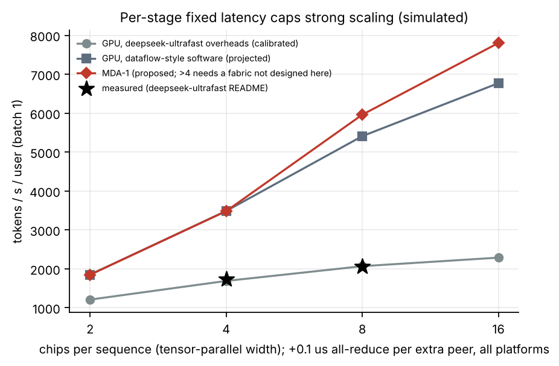
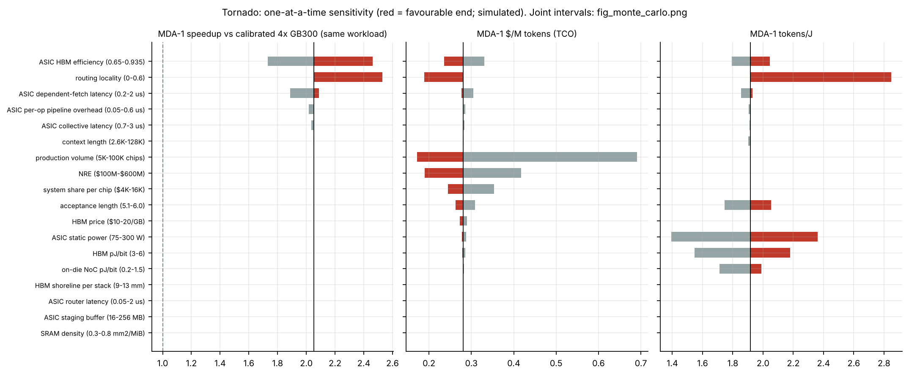

<!-- generated from docs/templates/04_results.md.j2 by experiments/render_docs.py; edit the template -->
# 04 · Results

**Everything on this page is simulated or projected**, except numbers marked *measured*, which are
quoted from the deepseek-ultrafast README. Regenerate with `make reproduce`. Defaults: batch 1,
context 2.6K, acceptance 5.6 tokens/step, 4 chips at 8 TB/s HBM each.

## Calibration

The GPU execution model has two free parameters, fitted to the two measured step times. The as-built
engine is modeled with its padded expert layout, PDL, fused all-reduces and side streams (01 §1).

| parameter | fitted | independent reference |
|---|---|---|
| achieved HBM fraction on weight streams (η) | **0.774** | batch-1 megakernel on H100: 0.78; STREAM triad on B200: 0.935 at 128 GB arrays, ~0.52 at 4-16 GB |
| exposed latency per dependent kernel stage (κ) | **3.71 µs** | device-wide barrier >1 µs; CUDA-graph launch ~1.3 µs |
| *(fixed, not fitted)* all-reduce latency | 2.37 µs | best published 4-GPU small all-reduce (typical ~5 µs) |

| config | measured | model (joint fit) | leave-one-out (η = STREAM 0.935, κ fitted on the other config) |
|---|---|---|---|
| gb300_tp4 | 3.30 ms | 3.300 ms | 3.198 ms (-3.1%) |
| b300_tp8 | 2.71 ms | 2.710 ms | 2.812 ms (+3.8%) |

**How strong is this?** Not very, and we want to be clear about it. Two parameters fitted to two
points is exact by construction. The leave-one-out test has little power: any bandwidth prior from
0.70 to 0.90 predicts the other configuration within about ±3%, which is close to the README's own
run-to-run spread:

| η prior | κ (µs) | predicted TP8 | error |
|---|---|---|---|
| 0.65 | 2.90 | 2.597 ms | -4.2% |
| 0.7 | 3.26 | 2.647 ms | -2.3% |
| 0.75 | 3.57 | 2.691 ms | -0.7% |
| 0.774 | 3.71 | 2.710 ms | -0.0% |
| 0.8 | 3.85 | 2.729 ms | +0.7% |
| 0.85 | 4.09 | 2.763 ms | +1.9% |
| 0.9 | 4.30 | 2.793 ms | +3.1% |
| 0.935 | 4.44 | 2.812 ms | +3.8% |

What the data *do* pin is the sum of fixed costs given a bandwidth efficiency. We refit under every
alternative we could construct:

| alternative | fitted η | fitted κ (µs) | fixed share of the TP4 step |
|---|---|---|---|
| baseline | 0.774 | 3.71 | 50% |
| all-reduce 5 us (typical) | 0.774 | 3.12 | 50% |
| all-reduce 10 us | 0.774 | 2.00 | 50% |
| +0.5 us all-reduce per extra peer | 0.600 | 2.26 | 36% |
| routing locality 0.5 | 0.534 | 3.57 | 49% |
| context 32K | 0.774 | 3.70 | 50% |
| run-to-run: TP4 3.24, TP8 2.74 | 0.913 | 4.20 | 57% |
| run-to-run: TP4 3.37, TP8 2.69 | 0.672 | 3.24 | 44% |
| run-to-run: TP4 3.24, TP8 2.69 | 0.830 | 3.84 | 53% |
| run-to-run: TP4 3.37, TP8 2.74 | 0.725 | 3.60 | 48% |

**Fixed share: 36%-57%, central 50%.** The fit cannot separate
collective latency from other per-stage latency: 2.37, 5 and 10 µs all fit. GB300 and B300 also differ
in more than bytes per GPU: host, power limits, verify-head precision, adaptive-verify thresholds and
TP8-specific kernel variants. We model only the head precision and the padded layout. MDA-1 and the
GPU software projections use the fitted η; nothing else they do depends on these GPU parameters.

## Baseline vs proposed vs software

| platform | step (ms) | tok/s/user | HBM busy | GB/chip/step | kW | tokens/J † | $/M tok, owned ‡ |
|---|---|---|---|---|---|---|---|
| 4x GB300, deepseek-ultrafast (calibrated) | 3.30 | **1,697** | 50% | 10.17 | 3.36 | 0.51 | 0.909 |
| 8x B300, deepseek-ultrafast (calibrated) | 2.71 | **2,066** | 39% | 6.26 | 5.28 | 0.39 | 1.468 |
| 4x GB300, barrier-synced persistent kernel (projected) | 2.25 | **2,490** | 73% | 10.17 | 3.36 | 0.74 | 0.619 |
| 4x GB300, dataflow-style software (projected) | 1.61 | **3,486** | 97% | 9.65 | 3.36 | 1.04 | 0.442 |
| MDA-1 x4 (proposed) | 1.61 | **3,482** | 97% | 9.65 | 1.82 | 1.92 | 0.281 |
| 16x Alveo V80 FPGA | 4.75 | **1,180** | 98% | 3.05 | 2.43 | 0.49 | 1.360 |
| 4x Rubin, today's software (projected) | 2.34 | **2,395** | 29% | 10.17 | 4.32 | 0.55 | 0.657 |
| 4x Rubin, dataflow-style software (projected) | 0.87 | **6,453** | 75% | 9.65 | 4.32 | 1.49 | 0.244 |
| MDA-1 HBM4 x4 (projected) | 0.80 | **6,987** | 81% | 9.65 | 2.52 | 2.77 | 0.172 |

*measured:* 4 x GB300 1,740 tok/s (step 3.30 ms); 8 x B300 2,060 tok/s (step 2.71 ms).
Model tok/s = 5.6 / step. The README's tok/s is client wall clock and implies 5.74 tokens/step.
† GPU power: 60% of TDP (*assumption*). MDA-1: bottom-up incl. NoC and power-delivery loss.
‡ GPU $45K all-in (*assumption*), MDA-1 at cost + $300M NRE / 20K, 4 years, $0.0862/kWh, PUE 1.44.
A GPU prefill pool adds $0.028/M equally to every row: 92 ms of 4-GPU prefill per 4K-token agent turn, over a 5,142-token answer.
At the $9.50/GPU-hr market rental, today's GPU baseline costs $6.22/M.

**Headlines.**
* The **dataflow-style software** projection on the same 4 x GB300 reaches 3,486 tok/s/user (2.0x measured).
* **MDA-1** reaches 3,482 (2.0x measured), which is 1.00x the software at iso-bandwidth.
* MDA-1 runs at 97% of its HBM roofline (3,595 tok/s/user at the calibrated η).

## Joint uncertainty (Monte Carlo)

300 joint draws over every MDA-1 constant:
* η from 0.65 to 0.935;
* log-uniform: dependent-fetch latency 0.2-2 µs, collective latency 0.7-3 µs, staging 16-256 MB, per-op hand-off 0.05-0.6 µs, router 0.05-0.5 µs.

| | 5th pct | median | 95th pct | joint worst corner |
|---|---|---|---|---|
| MDA-1 vs calibrated 4 x GB300 model | 1.72x | 2.06x | 2.40x | 1.46x |
| MDA-1 vs *measured* 1,740 tok/s | 1.68x | 2.01x | 2.34x | |
| MDA-1 vs dataflow-style GPU software (shared physics drawn once; hand-off 0.3-1.5 µs and router 0.2-2 µs drawn for the GPU) | 1.00x | 1.04x | 1.20x | |

## Cost and energy: the only places silicon wins at batch 1

| GPU assumption | GPU today $/M | GPU software $/M | MDA-1 $/M | MDA-1 advantage vs GPU software |
|---|---|---|---|---|
| $25K per GPU | 0.535 | 0.261 | 0.281 | 0.93x |
| $45K per GPU | 0.909 | 0.442 | 0.281 | 1.57x |
| $65K per GPU | 1.282 | 0.624 | 0.281 | 2.22x |

| GPU power assumption | GPU today tok/J | GPU software tok/J | MDA-1 tok/J | MDA-1 advantage vs GPU software |
|---|---|---|---|---|
| 40% of TDP | 0.76 | 1.56 | 1.92 | 1.23x |
| 60% of TDP | 0.51 | 1.04 | 1.92 | 1.85x |
| 80% of TDP | 0.38 | 0.78 | 1.92 | 2.46x |
| 100% of TDP | 0.30 | 0.62 | 1.92 | 3.08x |

MDA-1 unit cost (`sim/cost.py`): silicon $271, HBM $2,880, package/test $2,500,
LPDDR $256, system share $8,000, **NRE share $15,000** → $28,907 per package, at manufacturing cost with no margin and no respin.
Break-even volume against GPUs owned at $45K:

| NRE | vs GPU today | vs GPU software |
|---|---|---|
| $150M | 1,800 | 4,600 |
| $300M | 3,600 | 9,200 |
| $600M | 7,100 | 18,300 |

## Ablation: software steps vs silicon

| step | type | tok/s/user | HBM busy |
|---|---|---|---|
| A0 4x GB300, deepseek-ultrafast (calibrated) | today | 1,697 | 50% |
| A1 + unpadded expert layout | software | 1,742 | 48% |
| A2 + persistent kernel, barrier per stage (1 us) | software | 2,587 | 72% |
| A3 + flag hand-offs instead of barriers (0.5 us), no prefetch | software | 2,750 | 77% |
| A4 + cross-layer weight prefetch into L2 (64 MB) | software | 3,382 | 94% |
| A5 + speed-of-light all-reduce (1.4 us) = dataflow-style GPU software | software | 3,486 | 97% |
| A6 MDA-1: on-chip hand-off (0.2 us), HW router (0.1 us), Engram off-HBM | silicon | 3,482 | 97% |

Every step before A6 runs on the GPUs Baseten already has. Removing per-stage completion latency
(A1→A3) and cross-layer prefetch (A3→A4) carry the gain. The silicon step adds
-0% at 4 chips.

## Strong scaling

| chips | GPU, today's overheads | GPU, dataflow software | MDA-1 |
|---|---|---|---|
| 2 | 1,208 | 1,850 | 1,849 |
| 4 | 1,688 | 3,486 | 3,482 |
| 8 | 2,067 | 5,408 | 5,960 |
| 16 | 2,287 | 6,770 | 7,802 |

Every platform gets +0.1 µs of all-reduce latency per extra peer. MDA-1 beyond 4 packages assumes a
switched fabric that is not designed here. Per-stage fixed latency caps strong scaling: today's
overheads flatten at about 2,000 tok/s/user. The shorter on-chip hand-off gives MDA-1
+15% over the same-physics GPU software at 16 chips.

## Batch: throughput vs interactivity

| batch | GPU today tok/s | GPU software tok/s | MDA-1 tok/s | GPU software $/M | MDA-1 $/M |
|---|---|---|---|---|---|
| 1 | 1,697 | 3,486 | 3,482 | 0.442 | 0.281 |
| 2 | 2,178 | 4,124 | 4,232 | 0.374 | 0.231 |
| 4 | 3,195 | 5,033 | 5,127 | 0.306 | 0.191 |
| 8 | 4,544 | 6,298 | 6,293 | 0.245 | 0.156 |
| 16 | 6,785 | 8,717 | 8,667 | 0.177 | 0.113 |
| 32 | 11,413 | 14,178 | 13,742 | 0.109 | 0.071 |
| 64 | 21,163 | 25,811 | 23,875 | 0.060 | 0.041 |
| 128 | 38,588 | 46,122 | 39,980 | 0.033 | 0.025 |
| 256 | 65,524 | 76,865 | 60,582 | 0.020 | 0.016 |

The batched GPUs are projections: deepseek-ultrafast serves one request at a time. All platforms use
two micro-batches. At batch 256 MDA-1 is compute-bound (60,582 vs 76,865 tok/s),
because it carries 40% of a B300's FLOPs. On an owned basis it stays cheaper per token at every batch
size we simulated, given the $45K GPU assumption.

## Context length

CSA2 keeps decode almost flat from 4K to 1M context. The indexer's linear scan is the only
context-proportional term, and the engine runs it replicated on every rank.

## HBM bandwidth

| HBM TB/s per chip | GPU today | GPU software | MDA-1 |
|---|---|---|---|
| 4.0 | 1,133 | 1,770 | 1,769 |
| 6.0 | 1,456 | 2,634 | 2,632 |
| 8.0 | 1,697 | 3,486 | 3,482 |
| 12.0 | 2,034 | 4,778 | 5,113 |
| 16.0 | 2,259 | 5,707 | 6,180 |
| 19.2 | 2,391 | 6,373 | 6,953 |

## Next generation

| platform (4 chips, 19.2 TB/s HBM4 each) | tok/s/user | tokens/J |
|---|---|---|
| Rubin, today's per-stage latency | 2,395 | 0.55 |
| Rubin, dataflow-style software | 6,453 | 1.49 |
| MDA-1 respin with the same HBM4 | 6,987 | 2.77 |

Rubin power is assumed (1.8 kW; not in sources); its bandwidth is NVIDIA's NVL72 figure (the HGX
page says 22 TB/s). HBM4 is priced at the 2027 forecast ($32/GB). With today's per-stage latency,
Rubin's 2.4x bandwidth buys +41%. With the dataflow execution model it buys 3.8x.

## SRAM / staging buffer

| staging MB | 0 | 4 | 8 | 16 | 32 | 64 | 128 | 256 | 
|---|---|---|---|---|---|---|---|---|
| tok/s/user | 3,077 | 3,478 | 3,482 | 3,482 | 3,482 | 3,482 | 3,482 | 3,482 | 

A few MB of staging per package captures the whole prefetch benefit at batch 1. With none, MDA-1 loses
12%.

## Expert cache

A sticky-Zipf trace generator was fit to the published DeepSeek-V2-Lite LRU miss rate (28% at 32 of 64
experts); we match it at 28% with stay = 0.6.
Applied to V4.1's 384 experts (per-package slice 4.7 MB):

| slots/layer | SRAM per package | LRU | LFU | Belady OPT |
|---|---|---|---|---|
| 6 | 1.1 GB | 0% | 1% | 17% |
| 12 | 2.3 GB | 0% | 3% | 26% |
| 24 | 4.5 GB | 14% | 7% | 36% |
| 48 | 9.0 GB | 22% | 13% | 48% |
| 96 | 18.0 GB | 32% | 25% | 63% |
| 192 | 36.1 GB | 54% | 51% | 80% |

**Negative result.** A useful expert cache needs gigabytes per package. The traces are synthetic;
real V4.1 routing traces would settle it.

## Tornado (one at a time; see the Monte Carlo for joint ranges)

| parameter | speedup vs calibrated GPU | $/M tok | tokens/J |
|---|---|---|---|
| ASIC HBM efficiency (0.65-0.935) | 1.73 → 2.46 | 0.331 → 0.236 | 1.79 → 2.04 |
| ASIC collective latency (0.7-3 us) | 2.04 → 2.05 | 0.283 → 0.281 | 1.91 → 1.92 |
| ASIC per-op pipeline overhead (0.05-0.6 us) | 2.02 → 2.05 | 0.286 → 0.281 | 1.90 → 1.92 |
| ASIC dependent-fetch latency (0.2-2 us) | 1.89 → 2.09 | 0.305 → 0.276 | 1.86 → 1.93 |
| ASIC router latency (0.05-2 us) | 2.05 → 2.05 | 0.281 → 0.281 | 1.92 → 1.92 |
| ASIC staging buffer (16-256 MB) | 2.05 → 2.05 | 0.281 → 0.281 | 1.92 → 1.92 |
| routing locality (0-0.6) | 2.05 → 2.53 | 0.281 → 0.189 | 1.92 → 2.85 |
| acceptance length (5.1-6.0) | 2.05 → 2.05 | 0.309 → 0.262 | 1.75 → 2.05 |
| context length (2.6K-128K) | 2.05 → 2.05 | 0.282 → 0.281 | 1.90 → 1.92 |
| NRE ($100M-$600M) | 2.05 → 2.05 | 0.418 → 0.190 | 1.92 → 1.92 |
| production volume (5K-100K chips) | 2.05 → 2.05 | 0.691 → 0.172 | 1.92 → 1.92 |
| HBM price ($10-20/GB) | 2.05 → 2.05 | 0.290 → 0.272 | 1.92 → 1.92 |
| system share per chip ($4K-16K) | 2.05 → 2.05 | 0.354 → 0.245 | 1.92 → 1.92 |
| SRAM density (0.3-0.8 mm2/MiB) | 2.05 → 2.05 | 0.281 → 0.281 | 1.92 → 1.92 |
| HBM shoreline per stack (9-13 mm) | 2.05 → 2.05 | 0.282 → 0.280 | 1.92 → 1.92 |
| HBM pJ/bit (3-6) | 2.05 → 2.05 | 0.285 → 0.279 | 1.55 → 2.18 |
| on-die NoC pJ/bit (0.2-1.5) | 2.05 → 2.05 | 0.283 → 0.280 | 1.71 → 1.99 |
| ASIC static power (75-300 W) | 2.05 → 2.05 | 0.288 → 0.278 | 1.39 → 2.36 |

## SCALE-Sim cross-check

SCALE-Sim v3 (cycle-level systolic simulator; compute stage only, see
`experiments/scalesim_crosscheck.py`) on per-chip GEMM shapes:

| array | shape (M x N x K) | cycles | utilization | our model |
|---|---|---|---|---|
| 128x128 WS | decode routed expert w13 (1 row/expert) (1 x 1152 x 5120) | 137,880 | 0.3% | - |
| 128x128 WS | decode wq_b shard (6 rows) (6 x 8192 x 1280) | 248,320 | 1.5% | - |
| 128x128 WS | decode batch-64 expert w13 (6 rows/expert) (6 x 1152 x 5120) | 139,680 | 1.5% | - |
| 128x128 WS | prefill expert w13 (8K chunk, 128 rows/expert) (128 x 1152 x 5120) | 183,600 | 25.1% | - |
| 128x128 OS | decode routed expert w13 (1 row/expert) (1 x 1152 x 5120) | 48,366 | 0.7% | - |
| 128x128 OS | decode wq_b shard (6 rows) (6 x 8192 x 1280) | 98,176 | 3.9% | - |
| 128x128 OS | decode batch-64 expert w13 (6 rows/expert) (6 x 1152 x 5120) | 48,366 | 4.5% | - |
| 128x128 OS | prefill expert w13 (8K chunk, 128 rows/expert) (128 x 1152 x 5120) | 48,366 | 95.3% | - |
| 16x1024 OS (MDA-1) | decode routed expert w13 (1 row/expert) (1 x 1152 x 5120) | 12,316 | 2.9% | 3.1% |
| 16x1024 OS (MDA-1) | decode wq_b shard (6 rows) (6 x 8192 x 1280) | 18,544 | 20.7% | 18.8% |
| 16x1024 OS (MDA-1) | decode batch-64 expert w13 (6 rows/expert) (6 x 1152 x 5120) | 12,316 | 17.5% | 18.8% |
| 16x1024 OS (MDA-1) | prefill expert w13 (8K chunk, 128 rows/expert) (128 x 1152 x 5120) | 98,528 | 46.8% | 50.0% |

Before this cross-check our matrix-efficiency factor was 0.8, which SCALE-Sim showed to be 1.5-1.7x
optimistic. We lowered it to 0.5. Batch-1 results did not move (bandwidth-bound); large-batch results fell.

## Prefill and TTFT

| | model (mfu 0.5) | measured | ratio |
|---|---|---|---|
| 1M-token prefill, gb300_tp4 | 2.43 s | 13.2 s | 5.4x |
| 1M-token prefill, b300_tp8 | 1.83 s | 11.7 s | 6.4x |

The reported prefill runs 5.4x slower than our roofline model. Scaling by that factor
on TP4 mispredicts TP8 by -15%. **Prefill is not a calibrated result.** MDA-1 is
decode-only by design, so TTFT keeps prefill on the GPU pool and adds the KV hand-off (400 Gb/s RDMA assumed):

| scenario | GPU TTFT | hybrid TTFT | KV handed off |
|---|---|---|---|
| short prompt (60 tokens, cold) | 57 ms | 55 ms | 1.4 MB (0.05 ms) |
| agent turn: 200K cached + 4K new | 95 ms | 93 ms | 5.0 MB (0.12 ms) |
| cold 128K prompt | 1,575 ms | 1,576 ms | 118.0 MB (2.38 ms) |

These figures are indicative only. For the short prompt the scaled model gives 57 ms,
against the README's client-side 40 ms.
