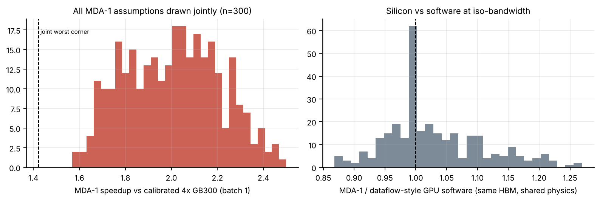
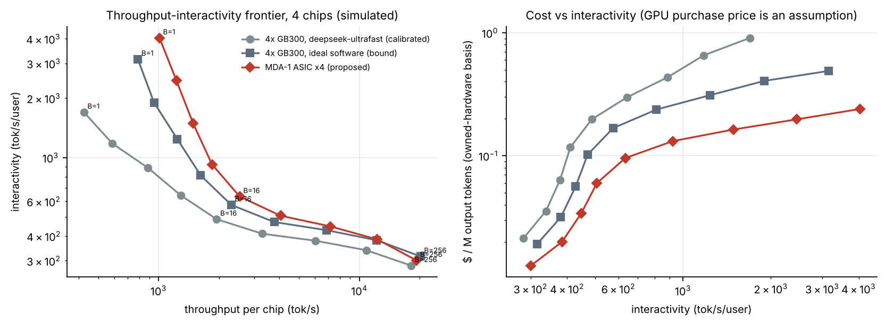
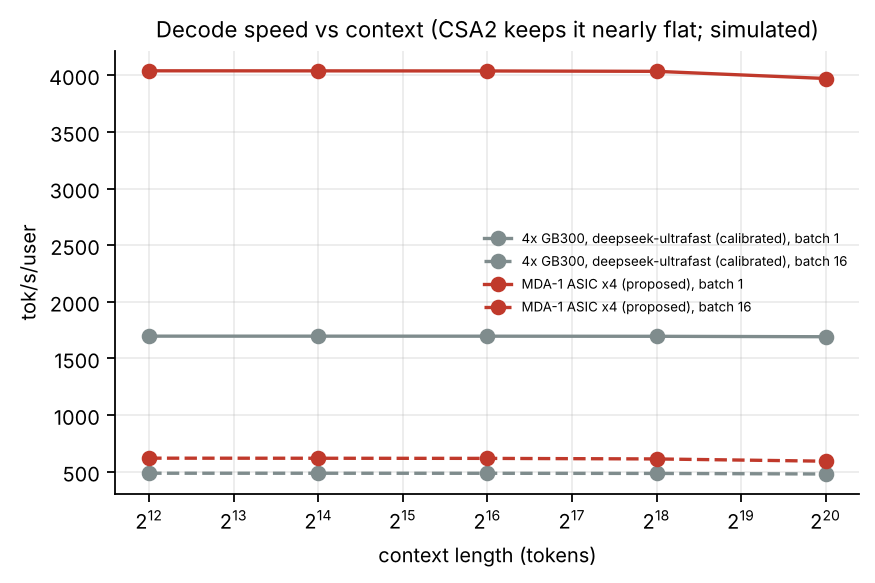
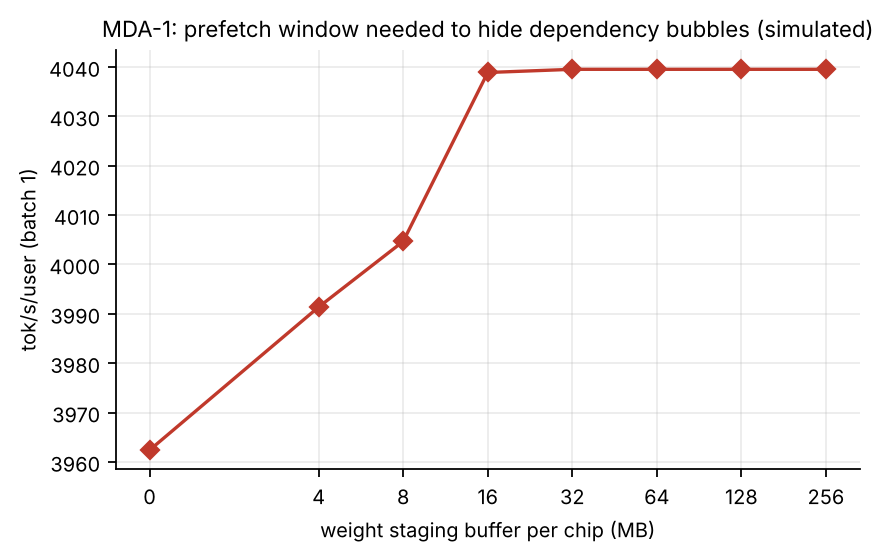

<!-- generated from docs/templates/04_results.md.j2 by experiments/render_docs.py; edit the template -->
# 04 · Results

**All numbers on this page are simulated or projected.** The exception is the numbers marked
*measured*, which we quote from the deepseek-ultrafast README. To regenerate the numbers, run
`make reproduce`. Defaults: batch 1, context 2.6K, acceptance 5.6 tokens/step, 4 chips at 8 TB/s HBM each.

## Calibration

The GPU execution model has two free parameters. We fitted them to the two measured step times.
The model of the as-built engine includes its padded expert layout, PDL, fused all-reduces and side
streams (01 §1).

| parameter | fitted | independent reference |
|---|---|---|
| achieved HBM fraction on weight streams (η) | **0.838** | batch-1 megakernel on H100: 0.78; STREAM triad on B200: 0.935 at 128 GB arrays, ~0.52 at 4-16 GB |
| exposed latency per dependent kernel stage (κ) | **4.21 µs** | device-wide barrier >1 µs; CUDA-graph launch ~1.3 µs |
| *(fixed, not fitted)* all-reduce latency | 2.37 µs | best published 4-GPU small all-reduce (typical ~5 µs) |

| config | measured | model (joint fit) | leave-one-out (η = STREAM 0.935, κ fitted on the other config) |
|---|---|---|---|
| gb300_tp4 | 3.30 ms | 3.300 ms | 3.238 ms (-1.9%) |
| b300_tp8 | 2.71 ms | 2.710 ms | 2.772 ms (+2.3%) |

**How strong is this calibration?** It is weak. A fit of two parameters to two points is exact by
construction. The leave-one-out test has little power. Any bandwidth prior from 0.70 to 0.90
predicts the other configuration with an error of about ±3% or less. This error is near the
run-to-run spread of the README:

| η prior | κ (µs) | predicted TP8 | error |
|---|---|---|---|
| 0.65 | 3.14 | 2.539 ms | -6.3% |
| 0.7 | 3.48 | 2.594 ms | -4.3% |
| 0.75 | 3.78 | 2.641 ms | -2.5% |
| 0.774 | 3.91 | 2.661 ms | -1.8% |
| 0.8 | 4.04 | 2.682 ms | -1.0% |
| 0.85 | 4.27 | 2.719 ms | +0.3% |
| 0.9 | 4.47 | 2.751 ms | +1.5% |
| 0.935 | 4.60 | 2.772 ms | +2.3% |

For a given bandwidth efficiency, the data *do* determine the sum of the fixed costs. We fitted the
model again for each alternative that we were able to construct:

| alternative | fitted η | fitted κ (µs) | fixed share of the TP4 step |
|---|---|---|---|
| baseline | 0.838 | 4.21 | 56% |
| all-reduce 5 us (typical) | 0.838 | 3.63 | 56% |
| all-reduce 10 us | 0.838 | 2.50 | 56% |
| +0.5 us all-reduce per extra peer | 0.649 | 2.91 | 43% |
| routing locality 0.5 | 0.572 | 4.02 | 54% |
| context 32K | 0.837 | 4.21 | 56% |
| run-to-run: TP4 3.24, TP8 2.74 | 0.988 | 4.63 | 62% |
| run-to-run: TP4 3.37, TP8 2.69 | 0.727 | 3.83 | 51% |
| run-to-run: TP4 3.24, TP8 2.69 | 0.898 | 4.31 | 58% |
| run-to-run: TP4 3.37, TP8 2.74 | 0.784 | 4.14 | 54% |

**Fixed share: 43%-62%, central 56%.** The fit cannot separate
collective latency from other per-stage latency. The values 2.37, 5 and 10 µs all fit.

GB300 and B300 also differ in more than bytes per GPU. They differ in host, power limits,
verify-head precision, adaptive-verify thresholds and TP8-specific kernel variants. We model only
the head precision and the padded layout. MDA-1 and the GPU software projections use the fitted η.
No other part of these projections depends on these GPU parameters.

## Baseline vs proposed vs software

| platform | step (ms) | tok/s/user | HBM busy | GB/chip/step | kW | tokens/J † | $/M tok, owned ‡ |
|---|---|---|---|---|---|---|---|
| 4x GB300, deepseek-ultrafast (calibrated) | 3.30 | **1,697** | 44% | 9.69 | 3.36 | 0.51 | 0.909 |
| 8x B300, deepseek-ultrafast (calibrated) | 2.71 | **2,066** | 32% | 5.51 | 5.28 | 0.39 | 1.468 |
| 4x GB300, barrier-synced persistent kernel (projected) | 2.05 | **2,728** | 70% | 9.69 | 3.36 | 0.81 | 0.565 |
| 4x GB300, dataflow-style software (projected) | 1.56 | **3,596** | 92% | 9.65 | 3.36 | 1.07 | 0.429 |
| MDA-1 x4 (proposed) | 1.53 | **3,656** | 94% | 9.65 | 1.87 | 1.95 | 0.268 |
| 16x Alveo V80 FPGA | 4.75 | **1,180** | 98% | 3.05 | 2.43 | 0.49 | 1.360 |
| 4x Rubin, today's software (projected) | 2.45 | **2,284** | 25% | 9.69 | 4.32 | 0.53 | 0.690 |
| 4x Rubin, dataflow-style software (projected) | 0.91 | **6,149** | 66% | 9.65 | 4.32 | 1.42 | 0.256 |
| MDA-1 HBM4 x4 (projected) | 0.91 | **6,159** | 66% | 9.65 | 2.30 | 2.67 | 0.194 |

- *measured:* 4 x GB300 1,740 tok/s (step 3.30 ms); 8 x B300 2,060 tok/s (step 2.71 ms).
- The tok/s of the model = 5.6 / step. The tok/s of the README is client wall-clock time, and it implies 5.74 tokens/step.
- † GPU power: 60% of TDP (*assumption*). MDA-1 power: a bottom-up estimate that includes NoC and power-delivery loss.
- ‡ GPU $45K all-in (*assumption*), MDA-1 at cost + $300M NRE / 20K, 4 years, $0.0862/kWh, PUE 1.44.
- A GPU prefill pool adds $0.027/M equally to each row. This cost is 89 ms of 4-GPU prefill for each 4K-token agent turn, divided over a 5,142-token answer. The prefill time comes from the roofline model, scaled to the measured 1M prefill. The headline $/token ratios include this cost.
- At the market rental price of $9.50/GPU-hr, today's GPU baseline costs $6.22/M.

**Headlines.**
- The **dataflow-style software** projection on the same 4 x GB300 reaches 3,596 tok/s/user (2.1x measured).
- **MDA-1** reaches 3,656 (2.1x measured). This is 1.02x the software projection at iso-bandwidth.
- MDA-1 runs at 94% of its HBM roofline (3,889 tok/s/user at the calibrated η).

## Joint uncertainty (Monte Carlo)

We made 300 joint draws over every MDA-1 constant:
- η from 0.65 to 0.935;
- log-uniform: dependent-fetch latency 0.17-1.5 µs, collective latency 1.4-4 µs, staging 16-256 MB;
- hand-off and router: each at most a factor of 3 from the base value of the platform. Thus the ranges favour neither side.

| | 5th pct | median | 95th pct | joint worst corner |
|---|---|---|---|---|
| MDA-1 vs calibrated 4 x GB300 model | 1.69x | 2.01x | 2.33x | 1.42x |
| MDA-1 vs *measured* 1,740 tok/s | 1.65x | 1.96x | 2.27x | |
| MDA-1 vs dataflow-style GPU software (shared physics drawn once per sample) | 0.92x | 1.01x | 1.19x | |

## Cost and energy: the only advantages of silicon at batch 1

| GPU assumption | GPU today $/M | GPU software $/M | MDA-1 $/M | MDA-1 advantage vs GPU software |
|---|---|---|---|---|
| $25K per GPU | 0.535 | 0.252 | 0.268 | 0.94x |
| $45K per GPU | 0.909 | 0.429 | 0.268 | 1.60x |
| $65K per GPU | 1.282 | 0.605 | 0.268 | 2.26x |

| GPU power assumption | GPU today tok/J | GPU software tok/J | MDA-1 tok/J | MDA-1 advantage vs GPU software |
|---|---|---|---|---|
| 40% of TDP | 0.76 | 1.61 | 1.95 | 1.22x |
| 60% of TDP | 0.51 | 1.07 | 1.95 | 1.82x |
| 80% of TDP | 0.38 | 0.80 | 1.95 | 2.43x |
| 100% of TDP | 0.30 | 0.64 | 1.95 | 3.04x |

MDA-1 unit cost (`sim/cost.py`):
- silicon $271;
- HBM $2,880;
- package/test $2,500;
- LPDDR $256;
- system share $8,000;
- **NRE share $15,000**.

The total is $28,907 for each package. This is the manufacturing cost, with no margin and no respin.

Break-even volume against GPUs owned at $45K:

| NRE | vs GPU today | vs GPU software |
|---|---|---|
| $150M | 1,700 | 4,500 |
| $300M | 3,400 | 9,000 |
| $600M | 6,800 | 17,900 |

## Ablation: software steps vs silicon

| step | type | tok/s/user | HBM busy |
|---|---|---|---|
| A0 4x GB300, deepseek-ultrafast (calibrated) | today | 1,697 | 44% |
| A1 + unpadded expert layout | software | 1,700 | 44% |
| A2 + one persistent program, barrier per stage (1 us; optimistic) | software | 2,736 | 70% |
| A3 + flag hand-offs instead of barriers (0.5 us), no prefetch | software | 2,919 | 75% |
| A4 + cross-layer weight prefetch into L2 (64 MB) = dataflow-style GPU software | software | 3,596 | 92% |
| A5 MDA-1: on-chip hand-off (0.3 us), HW router (0.1 us), Engram off-HBM | silicon | 3,656 | 94% |

Each step before A5 runs on the GPUs that Baseten already has. The persistent program (A1→A2) is
the largest step and the least certain step. It assumes that a stage hand-off can decrease from the fitted
4.2 µs to ~1 µs. The fit cannot confirm this, because κ combines launch residue, ramp,
tail and grid-wide completion. Flags (A2→A3) and cross-layer prefetch (A3→A4) are the next steps.
The silicon step adds +2% at 4 chips.

## Strong scaling

| chips | GPU, today's overheads | GPU, dataflow software | MDA-1 |
|---|---|---|---|
| 2 | 1,216 | 1,998 | 1,996 |
| 4 | 1,688 | 3,566 | 3,613 |
| 8 | 2,061 | 5,237 | 5,359 |
| 16 | 2,270 | 6,342 | 6,595 |

Each platform gets +0.1 µs of all-reduce latency for each extra peer. MDA-1 with more than
4 packages assumes a switched fabric. This study does not design that fabric, thus the 8-chip and
16-chip points of MDA-1 are illustrative only. Per-stage fixed latency limits strong scaling. With
today's overheads, the speed becomes flat at about 2,000-2,300 tok/s/user.

## Batch: throughput vs interactivity

| batch | GPU today tok/s | GPU software tok/s | MDA-1 tok/s | GPU software $/M | MDA-1 $/M |
|---|---|---|---|---|---|
| 1 | 1,697 | 3,596 | 3,656 | 0.429 | 0.268 |
| 2 | 2,166 | 4,267 | 4,268 | 0.361 | 0.229 |
| 4 | 3,303 | 5,286 | 5,324 | 0.292 | 0.184 |
| 8 | 4,846 | 6,675 | 6,591 | 0.231 | 0.149 |
| 16 | 7,378 | 9,304 | 9,148 | 0.166 | 0.107 |
| 32 | 12,502 | 15,131 | 14,510 | 0.102 | 0.068 |
| 64 | 23,127 | 27,483 | 25,097 | 0.056 | 0.039 |
| 128 | 41,943 | 48,871 | 41,674 | 0.032 | 0.024 |
| 256 | 70,677 | 80,912 | 62,511 | 0.019 | 0.016 |

The batched GPU numbers are projections, because deepseek-ultrafast serves one request at a time.
All platforms use two micro-batches. At batch 256, MDA-1 is compute-bound (62,511 vs 80,912 tok/s),
because it has 40% of the FLOPs of a B300. On an owned basis, MDA-1 costs less per token at each
batch size that we simulated. This result uses the $45K GPU assumption.

## Context length

CSA2 keeps decode almost flat from 4K to 1M context. The linear scan of the indexer is the only
context-proportional term. The engine runs a replica of this scan on each rank.

## HBM bandwidth

| HBM TB/s per chip | GPU today | GPU software | MDA-1 |
|---|---|---|---|
| 4.0 | 1,180 | 1,912 | 1,910 |
| 6.0 | 1,481 | 2,843 | 2,840 |
| 8.0 | 1,697 | 3,596 | 3,656 |
| 12.0 | 1,987 | 4,695 | 4,759 |
| 16.0 | 2,173 | 5,511 | 5,629 |
| 19.2 | 2,279 | 6,063 | 6,131 |

## Next generation

| platform (4 chips, 19.2 TB/s HBM4 each) | tok/s/user | tokens/J |
|---|---|---|
| Rubin, today's per-stage latency | 2,284 | 0.53 |
| Rubin, dataflow-style software | 6,149 | 1.42 |
| MDA-1 respin with the same HBM4 | 6,159 | 2.67 |

Rubin power is an assumption (1.8 kW; not in sources). Its bandwidth is the NVL72 figure from NVIDIA
(the HGX page says 22 TB/s). The HBM4 price is the 2027 forecast ($32/GB). With today's per-stage latency,
the 2.4x bandwidth of Rubin gives +35%. With dataflow-style software on both
platforms, it gives 1.71x. On Rubin, the software change alone gives 2.69x.

## SRAM / staging buffer

| staging MB | 0 | 4 | 8 | 16 | 32 | 64 | 128 | 256 | 
|---|---|---|---|---|---|---|---|---|
| tok/s/user | 3,039 | 3,528 | 3,538 | 3,563 | 3,609 | 3,621 | 3,656 | 3,664 | 

A few MB of staging for each package gives the full prefetch benefit at batch 1. With no staging, MDA-1 loses
17%.

## Expert cache

We fitted a sticky-Zipf trace generator to the published LRU miss rate of DeepSeek-V2-Lite (28% at
32 of 64 experts). We match it at 28% with stay = 0.6.
We applied the generator to the 384 experts of V4.1 (per-package slice 4.7 MB):

| slots/layer | SRAM per package | LRU | LFU | Belady OPT |
|---|---|---|---|---|
| 6 | 1.1 GB | 0% | 1% | 17% |
| 12 | 2.3 GB | 0% | 3% | 26% |
| 24 | 4.5 GB | 14% | 7% | 36% |
| 48 | 9.0 GB | 22% | 13% | 48% |
| 96 | 18.0 GB | 32% | 25% | 63% |
| 192 | 36.1 GB | 54% | 51% | 80% |

**Negative result.** A useful expert cache needs gigabytes for each package. The traces are
synthetic. Real V4.1 routing traces are necessary for a final answer.

## Tornado (one at a time; see the Monte Carlo for joint ranges)

| parameter | speedup vs calibrated GPU | $/M tok | tokens/J |
|---|---|---|---|
| ASIC HBM efficiency (0.65-0.935) | 1.73 → 2.33 | 0.331 → 0.249 | 1.79 → 2.01 |
| ASIC collective latency (1.4-5 us) | 1.91 → 2.21 | 0.301 → 0.261 | 1.86 → 1.97 |
| ASIC per-op hand-off (0.1-0.9 us) | 1.89 → 2.21 | 0.305 → 0.261 | 1.86 → 1.97 |
| ASIC dependent-fetch latency (0.2-2 us) | 1.97 → 2.18 | 0.292 → 0.265 | 1.89 → 1.96 |
| ASIC router latency (0.03-0.33 us) | 2.14 → 2.16 | 0.270 → 0.267 | 1.95 → 1.96 |
| ASIC staging buffer (16-256 MB) | 2.10 → 2.16 | 0.275 → 0.268 | 1.93 → 1.95 |
| routing locality (0-0.6) | 2.15 → 2.70 | 0.268 → 0.182 | 1.95 → 2.89 |
| acceptance length (5.1-6.0) | 2.15 → 2.15 | 0.295 → 0.250 | 1.78 → 2.09 |
| context length (2.6K-128K) | 2.12 → 2.15 | 0.273 → 0.268 | 1.93 → 1.95 |
| NRE ($100M-$600M) | 2.15 → 2.15 | 0.398 → 0.182 | 1.95 → 1.95 |
| production volume (5K-100K chips) | 2.15 → 2.15 | 0.658 → 0.164 | 1.95 → 1.95 |
| HBM price ($10-20/GB) | 2.15 → 2.15 | 0.277 → 0.260 | 1.95 → 1.95 |
| system share per chip ($4K-16K) | 2.15 → 2.15 | 0.338 → 0.234 | 1.95 → 1.95 |
| SRAM density (0.3-0.8 mm2/MiB) | 2.15 → 2.15 | 0.268 → 0.268 | 1.95 → 1.95 |
| HBM shoreline per stack (9-13 mm) | 2.15 → 2.15 | 0.269 → 0.268 | 1.95 → 1.95 |
| HBM pJ/bit (3-6) | 2.15 → 2.15 | 0.273 → 0.266 | 1.57 → 2.22 |
| on-die NoC pJ/bit (0.2-1.5) | 2.15 → 2.15 | 0.270 → 0.268 | 1.74 → 2.03 |
| ASIC static power (75-300 W) | 2.15 → 2.15 | 0.275 → 0.265 | 1.43 → 2.39 |

## SCALE-Sim cross-check

We ran SCALE-Sim v3 on per-chip GEMM shapes. SCALE-Sim v3 is a cycle-level systolic simulator. We
used it for the compute stage only (see `experiments/scalesim_crosscheck.py`):

| array | shape (M x N x K) | cycles | utilization | our model |
|---|---|---|---|---|
| 128x128 WS | decode routed expert w13 (1 row/expert) (1 x 1152 x 5120) | 137,880 | 0.3% | - |
| 128x128 WS | decode wq_b shard (6 rows) (6 x 8192 x 1280) | 248,320 | 1.5% | - |
| 128x128 WS | decode batch-64 expert w13 (6 rows/expert) (6 x 1152 x 5120) | 139,680 | 1.5% | - |
| 128x128 WS | prefill expert w13 (8K chunk, 128 rows/expert) (128 x 1152 x 5120) | 183,600 | 25.1% | - |
| 128x128 OS | decode routed expert w13 (1 row/expert) (1 x 1152 x 5120) | 48,366 | 0.7% | - |
| 128x128 OS | decode wq_b shard (6 rows) (6 x 8192 x 1280) | 98,176 | 3.9% | - |
| 128x128 OS | decode batch-64 expert w13 (6 rows/expert) (6 x 1152 x 5120) | 48,366 | 4.5% | - |
| 128x128 OS | prefill expert w13 (8K chunk, 128 rows/expert) (128 x 1152 x 5120) | 48,366 | 95.3% | - |
| 16x1024 OS (MDA-1) | decode routed expert w13 (1 row/expert) (1 x 1152 x 5120) | 12,316 | 2.9% | 3.1% |
| 16x1024 OS (MDA-1) | decode wq_b shard (6 rows) (6 x 8192 x 1280) | 18,544 | 20.7% | 18.8% |
| 16x1024 OS (MDA-1) | decode batch-64 expert w13 (6 rows/expert) (6 x 1152 x 5120) | 12,316 | 17.5% | 18.8% |
| 16x1024 OS (MDA-1) | prefill expert w13 (8K chunk, 128 rows/expert) (128 x 1152 x 5120) | 98,528 | 46.8% | 50.0% |

Before this cross-check, our matrix-efficiency factor was 0.8. SCALE-Sim showed that this value was
1.5-1.7x optimistic. We decreased it to 0.5. The batch-1 results did not change, because they are
bandwidth-bound. The large-batch results decreased.

## Prefill and TTFT

| | model (mfu 0.5) | measured | ratio |
|---|---|---|---|
| 1M-token prefill, gb300_tp4 | 2.45 s | 13.2 s | 5.4x |
| 1M-token prefill, b300_tp8 | 1.84 s | 11.7 s | 6.3x |

The reported prefill is 5.4x slower than our roofline model. When we scale the model by that
factor on TP4, it mispredicts TP8 by -15%. **Prefill is not a calibrated result.** MDA-1 is
decode-only by design. Thus the TTFT model keeps prefill on the GPU pool and adds the KV hand-off (assumed: 400 Gb/s RDMA):

| scenario | GPU TTFT | hybrid TTFT | KV handed off |
|---|---|---|---|
| short prompt (60 tokens, cold) | 55 ms | 53 ms | 1.4 MB (0.05 ms) |
| agent turn: 200K cached + 4K new | 92 ms | 90 ms | 5.0 MB (0.12 ms) |
| cold 128K prompt | 1,575 ms | 1,576 ms | 118.0 MB (2.38 ms) |

These figures are indicative only. For the short prompt, the scaled model gives 55 ms.
The README gives a client-side value of 40 ms.
