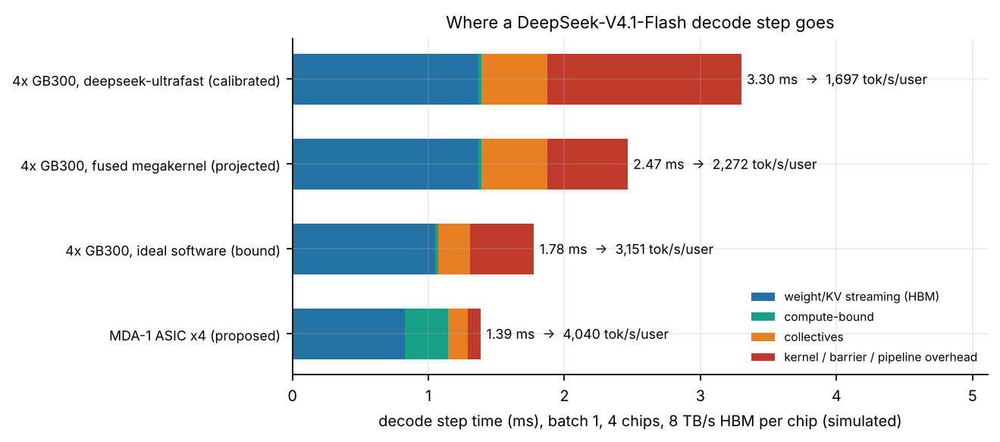
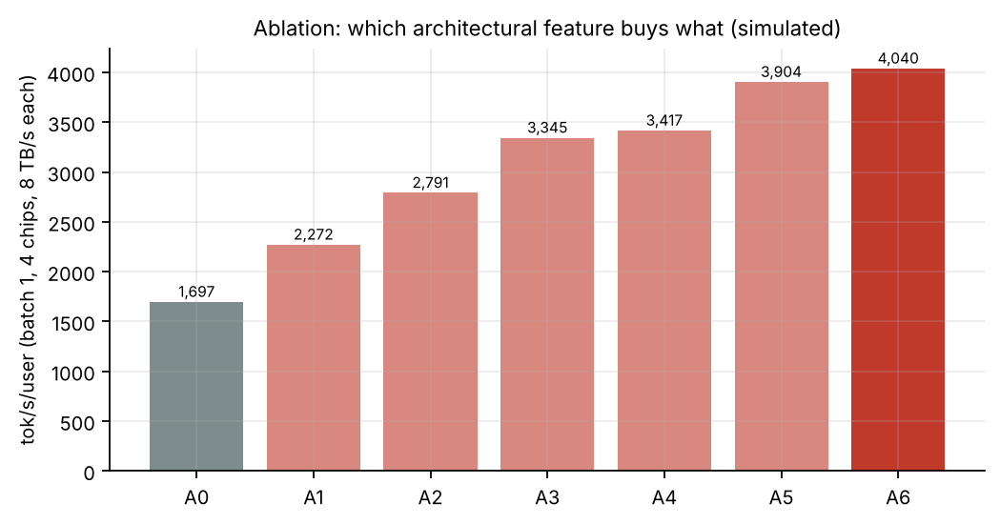
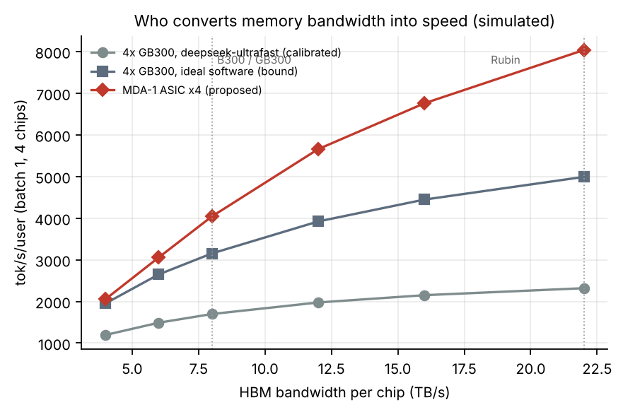
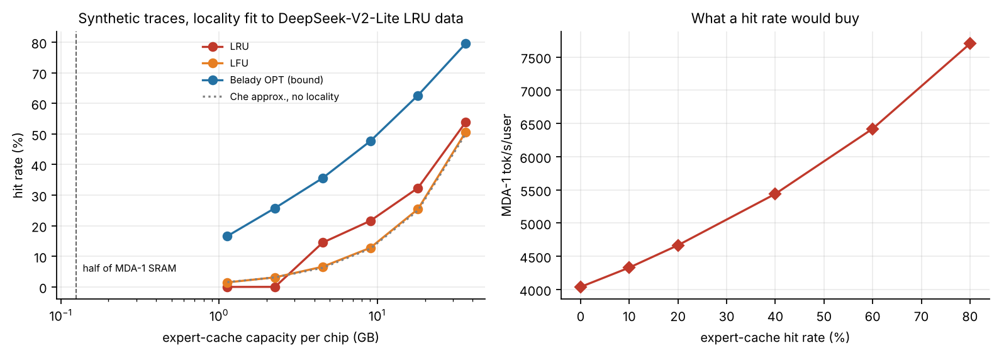

<!-- generated from docs/templates/04_results.md.j2 by experiments/render_docs.py; edit the template -->
# 04 · Results

**Everything on this page is simulated or projected**, except numbers explicitly marked *measured*,
which are quoted from the deepseek-ultrafast README. Regenerate with `make reproduce`.
Unless stated otherwise: batch 1, context 2.6K, acceptance 5.6 tokens/step, 4 chips at 8 TB/s HBM each.

## Calibration

The GPU execution model has two free parameters, fitted to the two measured step times:

| parameter | fitted | independent reference |
|---|---|---|
| achieved HBM fraction on weight streams | **0.868** | B200 STREAM triad 0.935; DGX H100 0.934; batch-1 megakernel on H100 0.78 |
| exposed time per kernel boundary | **2.42 µs** | CUDA-graph launch about 1.3 µs (H100), plus barrier/tail above 1 µs |
| *(fixed, not fitted)* all-reduce latency | 5.0 µs | "roughly 5 µs on four GPUs" (4 x GB200) |

| config | measured | model (joint fit) | **leave-one-out** (η fixed at STREAM 0.935, κ fitted on the other config) |
|---|---|---|---|
| gb300_tp4 | 3.30 ms | 3.300 ms | 3.257 ms (**-1.3%**) |
| b300_tp8 | 2.71 ms | 2.710 ms | 2.753 ms (**+1.6%**) |

A 2-parameter fit to 2 points is exact by construction, so the meaningful error is the leave-one-out
column. With bandwidth efficiency pinned to an independent STREAM measurement, a model calibrated
on one configuration predicts the other's step time to within **1.6%**.
Both points sit inside the README's run-to-run range (3.24-3.37 ms and 2.69-2.74 ms).
The leave-one-out error stays below 2% for any bandwidth prior between 0.80 and 0.95:

| η prior | κ (µs) | predicted TP8 | error |
|---|---|---|---|
| 0.75 | 2.05 | 2.617 ms | -3.4% |
| 0.8 | 2.22 | 2.660 ms | -1.8% |
| 0.85 | 2.37 | 2.698 ms | -0.5% |
| 0.868 | 2.42 | 2.710 ms | +0.0% |
| 0.9 | 2.51 | 2.731 ms | +0.8% |
| 0.935 | 2.59 | 2.753 ms | +1.6% |
| 0.95 | 2.63 | 2.761 ms | +1.9% |

**What the calibration cannot identify, and why the conclusion survives it.** Kernel overhead and
collective latency are fixed costs that the data cannot tell apart. Routing locality and the
per-peer growth of all-reduce latency trade off against bandwidth efficiency. We refit under each
alternative:

| alternative assumption | fitted η | fitted κ (µs) | fixed share of the TP4 step |
|---|---|---|---|
| baseline | 0.868 | 2.42 | 58% |
| collective latency 2.37 us | 0.868 | 2.85 | 58% |
| collective latency 10 us | 0.868 | 1.61 | 58% |
| +0.5 us per extra peer | 0.672 | 1.59 | 46% |
| routing locality 0.5 | 0.592 | 2.30 | 56% |
| context 32K | 0.868 | 2.42 | 58% |

The fixed share never drops below 46%. The alternatives that lower it need
bandwidth efficiencies (0.59-0.67) far below every published stream measurement. MDA-1's projections
do not depend on these GPU parameters at all; only the GPU baselines do.

## Baseline vs proposed

| platform | step (ms) | tok/s/user | HBM busy | GB/chip/step | power (kW) | tokens/J | $/M tok (rental*) | $/M tok (owned) |
|---|---|---|---|---|---|---|---|---|
| 4x GB300, deepseek-ultrafast (calibrated) | 3.30 | **1,697** | 42% | 9.65 | 3.36 | 0.51 | 6.22 | 0.91 |
| 8x B300, deepseek-ultrafast (calibrated) | 2.71 | **2,066** | 29% | 5.33 | 5.28 | 0.39 | 10.22 | 1.47 |
| 4x GB300, fused megakernel (projected) | 2.47 | **2,272** | 56% | 9.65 | 3.36 | 0.68 | 4.65 | 0.68 |
| 4x GB300, ideal software (bound) | 1.78 | **3,151** | 78% | 9.65 | 3.36 | 0.94 | 3.35 | 0.49 |
| MDA-1 ASIC x4 (proposed) | 1.39 | **4,040** | 97% | 9.65 | 1.65 | 2.45 | - | 0.24 |
| 16x Alveo V80 FPGA | 4.75 | **1,179** | 98% | 3.04 | 2.43 | 0.48 | - | 1.36 |
| 4x Rubin, today's software (projected) | 2.41 | **2,323** | 21% | 9.65 | 4.32 | 0.54 | 4.54 | 0.68 |
| MDA-1 HBM4 x4 (projected) | 0.82 | **6,796** | 81% | 9.65 | 1.99 | 3.42 | - | 0.15 |

*measured:* 4 x GB300 1,740 tok/s; 8 x B300 2,060 tok/s. The model's tok/s = 5.6 / step time; the README's tok/s is client-side wall clock.
\*Rental: $9.50/GPU-hr (B300 market median). Owned: GPUs at an **assumed** $45K each all-in (no public price; swept $25-65K, giving $0.54-1.28/M tok for the calibrated GPU). ASIC/FPGA: owned TCO over 4 years, including NRE. GPU power is 60% of TDP (assumption). ASIC power is bottom-up.

Headlines at iso-HBM-bandwidth (4 chips, 8 TB/s each):

* **2.3x the measured 4 x GB300** per user (4,040 vs 1,740 tok/s). Across all ASIC-side uncertainties in the tornado, the speedup over the calibrated GPU model stays between **2.12x and 2.51x**.
* **1.28x the ideal-software GPU bound.** Most of the batch-1 gain at 4 chips is, in principle, available to GPU software.
* **4.9x tokens/J; 3.8x lower $/M tokens** than the calibrated GPU owned at $45K/GPU (and 2.0x lower than the ideal-software GPU on the same basis).

**Cost basis matters.** Against the GPU *rental* price the ratio is 26x. That number mixes cloud and vendor margins into the comparison, so we don't use it as a headline.

ASIC unit cost (`sim/cost.py`): die $207, HBM $2,880, package/test $2,500,
LPDDR $256, system share $8,000, **NRE share $15,000**
→ $28,843 per chip.

## Ablation

Each step adds one feature to the calibrated GPU on the same HBM:

| step | tok/s/user | HBM busy |
|---|---|---|
| A0  4x GB300, deepseek-ultrafast (calibrated) | 1,697 | 42% |
| A1  + one persistent program (no launches; barrier per stage) | 2,272 | 56% |
| A2  + statically scheduled pipeline (no barriers) | 2,791 | 69% |
| A3  + cross-layer weight prefetch (128 MB staging SRAM) | 3,345 | 83% |
| A4  + hardware MoE router (gate -> expert DMA in 0.1 us) | 3,417 | 85% |
| A5  + in-fabric all-reduce (5 -> 1.4 us) | 3,904 | 97% |
| A6  = MDA-1 (its HBM efficiency 0.90, compute, Engram in LPDDR) | 4,040 | 97% |

The biggest single lever is removing per-kernel overhead (A0→A2). Weight prefetch (A3) and fast
collectives (A5) matter once overhead is gone. The hardware router (A4) is worth little *because*
prefetch hides it. Sharding the GPU-replicated projections, a co-design option, *loses* on MDA-1
(3,576 tok/s/user).

## Strong scaling

| chips | GPU (calibrated) | GPU megakernel | GPU ideal SW | MDA-1 |
|---|---|---|---|---|
| 2 | 1,227 | 1,501 | 1,984 | **2,147** |
| 4 | 1,688 | 2,256 | 3,121 | **4,040** |
| 8 | 2,059 | 2,971 | 4,281 | **6,464** |
| 16 | 2,264 | 3,416 | 4,945 | **8,122** |

(+0.1 µs all-reduce latency per extra peer for every platform.) At 8 chips MDA-1 projects
6,464 tok/s/user: **3.1x the measured 8 x B300**, and 1.51x the ideal-software GPU.
Fixed per-layer latency is a strong-scaling wall: it is why the GPU curves flatten.

## Batch: throughput vs interactivity

| batch | GPU tok/s (4 chips) | MDA-1 tok/s (4 chips) | GPU $/M (owned) | MDA-1 $/M |
|---|---|---|---|---|
| 1 | 1,697 | 4,040 | 0.909 | 0.240 |
| 2 | 2,354 | 4,801 | 0.655 | 0.202 |
| 4 | 3,544 | 5,867 | 0.435 | 0.166 |
| 8 | 5,149 | 7,194 | 0.299 | 0.135 |
| 16 | 7,788 | 9,918 | 0.198 | 0.098 |
| 32 | 13,148 | 15,638 | 0.117 | 0.062 |
| 64 | 24,230 | 26,840 | 0.064 | 0.036 |
| 128 | 43,379 | 44,070 | 0.036 | 0.022 |
| 256 | 72,532 | 65,190 | 0.021 | 0.015 |

The batched GPU is a projection: deepseek-ultrafast serves one request at a time. Both platforms use
two micro-batches that overlap one's expert streaming with the other's attention. MDA-1 leads at low
batch and is at or slightly above parity from batch 16 to 128. At batch 256 it is compute-bound
(65,190 vs 72,532 tok/s) because it carries 40% of a B300's FLOPs. It still costs less per
token on an owned basis at every batch size we simulated.

## Context length

CSA2 keeps decode almost flat from 4K to 1M context: MDA-1 at batch 1 goes from
4,039 to 3,971 tok/s/user. The indexer's linear scan
(layer 20 scans all positions) is the only context-proportional term.

## HBM bandwidth

| HBM TB/s per chip | GPU (calibrated) | GPU ideal SW | MDA-1 |
|---|---|---|---|
| 4 | 1,194 | 1,952 | 2,054 |
| 6 | 1,488 | 2,648 | 3,055 |
| 8 | 1,697 | 3,151 | 4,040 |
| 12 | 1,974 | 3,920 | 5,656 |
| 16 | 2,149 | 4,445 | 6,757 |
| 22 | 2,317 | 4,990 | 8,036 |

With today's per-layer overheads, the GPU turns 2.75x more bandwidth (8 → 22 TB/s) into only
37% more speed. MDA-1 turns it into 99%.

## Next generation

| platform | tok/s/user | tokens/J |
|---|---|---|
| 4 x Rubin (22 TB/s HBM4), today's software overheads | 2,323 | 0.54 |
| MDA-1 respin with 8 x HBM4 (16 TB/s, JEDEC rate) | 6,796 | 3.42 |

Rubin's power is assumed (1.8 kW TGP; not in sources). With Rubin's software overheads unchanged
from today, MDA-1-HBM4 projects 2.9x the per-user speed on less bandwidth.
With ideal software the gap would shrink, as it does for GB300.

## SRAM / staging buffer

| staging MB | 0 | 4 | 8 | 16 | 32 | 64 | 128 | 256 | 
|---|---|---|---|---|---|---|---|---|
| tok/s/user | 3,476 | 3,990 | 4,003 | 4,030 | 4,040 | 4,040 | 4,040 | 4,040 | 

The prefetch knee is at about 32 MB per chip. With no staging, MDA-1 loses 14%.

## Expert cache

We fit a sticky-Zipf trace generator to the published DeepSeek-V2-Lite LRU miss rate: 28% at 32 of 64
experts, matched at 28% with stay = 0.6.
Applied to V4.1's 384 experts, with each per-chip expert slice 4.7 MB:

| slots/layer | SRAM per chip | LRU | LFU | Belady OPT |
|---|---|---|---|---|
| 6 | 1.1 GB | 0% | 1% | 17% |
| 12 | 2.3 GB | 0% | 3% | 26% |
| 24 | 4.5 GB | 14% | 7% | 36% |
| 48 | 9.0 GB | 22% | 13% | 48% |
| 96 | 18.0 GB | 32% | 25% | 63% |
| 192 | 36.1 GB | 54% | 51% | 80% |

**Negative result.** An expert cache that would matter needs gigabytes per chip, and SRAM offers
hundreds of megabytes. Hit rate would pay handsomely (5,440 tok/s/user at 40%) if it
could be had. The traces are synthetic; real V4.1 routing traces would settle it.

## Tornado

One-at-a-time ranges (low → high):

| parameter | speedup vs GPU model | $/M tok | tokens/J |
|---|---|---|---|
| ASIC HBM efficiency (0.80-0.95) | 2.12 → 2.51 | 0.268 → 0.229 | 2.35 → 2.50 |
| ASIC collective latency (0.7-3 us) | 2.23 → 2.38 | 0.256 → 0.240 | 2.39 → 2.45 |
| ASIC per-op pipeline overhead (0.05-0.6 us) | 2.24 → 2.38 | 0.255 → 0.240 | 2.40 → 2.45 |
| ASIC dependent-fetch latency (0.2-2 us) | 2.18 → 2.43 | 0.262 → 0.236 | 2.37 → 2.47 |
| ASIC router latency (0.05-2 us) | 2.34 → 2.38 | 0.244 → 0.240 | 2.44 → 2.45 |
| ASIC staging buffer (16-256 MB) | 2.37 → 2.38 | 0.241 → 0.240 | 2.45 → 2.45 |
| routing locality (0-0.6) | 2.38 → 3.04 | 0.240 → 0.162 | 2.45 → 3.64 |
| acceptance length (5.1-6.1) | 2.38 → 2.38 | 0.264 → 0.221 | 2.23 → 2.67 |
| context length (2.6K-128K) | 2.38 → 2.38 | 0.240 → 0.240 | 2.45 → 2.45 |
| NRE ($100M-$600M) | 2.38 → 2.38 | 0.358 → 0.162 | 2.45 → 2.45 |
| production volume (5K-100K chips) | 2.38 → 2.38 | 0.593 → 0.146 | 2.45 → 2.45 |
| HBM price ($10-20/GB) | 2.38 → 2.38 | 0.248 → 0.233 | 2.45 → 2.45 |
| system share per chip ($4K-16K) | 2.38 → 2.38 | 0.303 → 0.209 | 2.45 → 2.45 |
| SRAM density (0.3-0.8 mm2/MiB) | 2.38 → 2.38 | 0.241 → 0.240 | 2.45 → 2.45 |
| FP8 MAC area (40-200 um2) | 2.38 → 2.38 | 0.241 → 0.240 | 2.45 → 2.45 |
| HBM pJ/bit (3-6) | 2.38 → 2.38 | 0.244 → 0.238 | 1.93 → 2.84 |
| ASIC static power (75-300 W) | 2.38 → 2.38 | 0.245 → 0.238 | 1.80 → 3.00 |

Speed depends mostly on HBM efficiency and dependent-fetch latency. Routing locality and acceptance
length are workload properties that move GPU and ASIC together; we show the ratio. Cost depends mostly
on **production volume and NRE**.

## SCALE-Sim cross-check

SCALE-Sim v3 (cycle-level systolic simulator; compute stage only, see
`experiments/scalesim_crosscheck.py`) on per-chip GEMM shapes:

| array | shape (M x N x K) | cycles | utilization | our model |
|---|---|---|---|---|
| 128x128 WS | decode routed expert w13 (1 row/expert) (1 x 1152 x 5120) | 137,880 | 0.3% | - |
| 128x128 WS | decode wq_b shard (6 rows) (6 x 8192 x 1280) | 248,320 | 1.5% | - |
| 128x128 WS | decode batch-64 expert w13 (6 rows/expert) (6 x 1152 x 5120) | 139,680 | 1.5% | - |
| 128x128 WS | prefill expert w13 (8K chunk, 128 rows/expert) (128 x 1152 x 5120) | 183,600 | 25.1% | - |
| 128x128 OS | decode routed expert w13 (1 row/expert) (1 x 1152 x 5120) | 48,366 | 0.7% | - |
| 128x128 OS | decode wq_b shard (6 rows) (6 x 8192 x 1280) | 98,176 | 3.9% | - |
| 128x128 OS | decode batch-64 expert w13 (6 rows/expert) (6 x 1152 x 5120) | 48,366 | 4.5% | - |
| 128x128 OS | prefill expert w13 (8K chunk, 128 rows/expert) (128 x 1152 x 5120) | 48,366 | 95.3% | - |
| 16x1024 OS (MDA-1) | decode routed expert w13 (1 row/expert) (1 x 1152 x 5120) | 12,316 | 2.9% | 3.1% |
| 16x1024 OS (MDA-1) | decode wq_b shard (6 rows) (6 x 8192 x 1280) | 18,544 | 20.7% | 18.8% |
| 16x1024 OS (MDA-1) | decode batch-64 expert w13 (6 rows/expert) (6 x 1152 x 5120) | 12,316 | 17.5% | 18.8% |
| 16x1024 OS (MDA-1) | prefill expert w13 (8K chunk, 128 rows/expert) (128 x 1152 x 5120) | 98,528 | 46.8% | 50.0% |

Before this cross-check our matrix-efficiency factor was 0.8, which SCALE-Sim showed to be 1.5-1.7x
optimistic for these shapes. **We lowered it to 0.5.** Batch-1 results did not move, because they are
bandwidth-bound. Large-batch results fell, and are reported above with the corrected value. A
conventional 128x128 array would make batch-1 decode compute-bound: 0.3-1.5% utilization.

## Prefill and TTFT

| | model (mfu 0.5) | measured | ratio |
|---|---|---|---|
| 1M-token prefill, gb300_tp4 | 2.40 s | 13.2 s | 5.5x |
| 1M-token prefill, b300_tp8 | 1.79 s | 11.7 s | 6.5x |

The reported prefill runs 5.5x slower than our roofline model. Scaling the model
by that factor on TP4 mispredicts TP8 by -16%: measured TP4→TP8 speedup is
1.13x; the model says 1.34x. So the prefill path has large costs we do not
model, and **prefill is not a calibrated result**. MDA-1 is decode-only by design. TTFT keeps prefill
on the GPU pool and adds the KV hand-off (400 Gb/s RDMA assumed):

| scenario | GPU TTFT | hybrid TTFT (GPU prefill → MDA-1) | KV handed off |
|---|---|---|---|
| short prompt (60 tokens, cold) | 50 ms | 48 ms | 1.4 MB (0.05 ms) |
| agent turn: 200K cached + 4K new | 87 ms | 86 ms | 5.0 MB (0.12 ms) |
| cold 128K prompt | 1,570 ms | 1,570 ms | 118.0 MB (2.38 ms) |

TTFT is unchanged, as intended. For the short prompt the scaled model gives 50 ms
against the README's client-side 40 ms (which also includes HTTP and tokenization). The prefill
scaling factor, fitted at 1M tokens, over-predicts short prompts.
TTFT figures are therefore indicative only.
